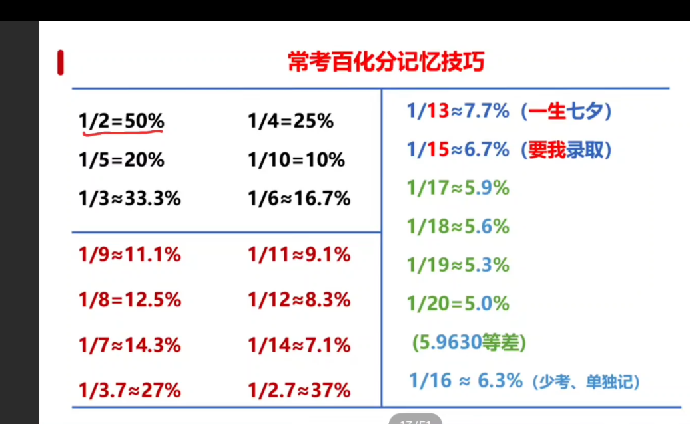

# KFC

广东公考（省考）备考资料 + 个人技术笔记。

---

## 行测

| 模块 | 文档 |
|------|------|
| 做题顺序 / 时间分配 | [hello.md](hello.md) |
| 言语理解 | [言语.md](言语.md) |
| 判断推理 | [推理.md](推理.md) |
| 数量关系 | [数量.md](数量.md) |
| 资料分析 | [数字资料.md](数字资料.md) |
| 常识判断 | [常识.md](常识.md) |
| 政治理论 | [政治理论.md](政治理论.md) |
| 计算技巧 | [计算技巧.md](计算技巧.md) |

## 申论

| 类型 | 文档 |
|------|------|
| 写作方法论 | [申论要点理解总结和重组.md](申论要点理解总结和重组.md) |
| 素材 / 金句 / 范文 | [申论积累.md](申论积累.md) |

## 备考经验

- [经验/学习经验.md](经验/学习经验.md) —— 21 天计划、名师推荐、广东专项
- [经验/道理.md](经验/道理.md)
- [经验/一个抖音经验帖子.md](经验/一个抖音经验帖子.md)

## 一图流

## 技术笔记

见 [技术文章/](技术文章/) 目录，含 Git、MinGW/C 编译、Markdown 语法、蓝牙协议等。

---

> 图片统一存放在 `images/` 与 `assets/` 目录，文档内全部使用相对路径引用。
