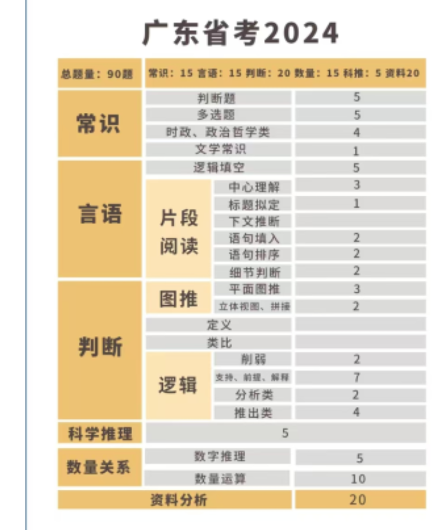

# KFC

广东公考（省考）备考资料 + 个人技术笔记。

---

## 行测

### 言语理解
- [言语.md](言语.md) —— 中心理解七大关系
- [言语逻辑填空.md](言语逻辑填空.md)
- [言语词语记忆.txt](言语词语记忆.txt)

### 判断推理
- [推理.md](推理.md) —— 图推基础
- [图推/图形推理学习.md](图推/图形推理学习.md) ｜ [图推/题目记录.md](图推/题目记录.md)
- [逻辑推理/逻辑推理提纲学习.md](逻辑推理/逻辑推理提纲学习.md) ｜ [逻辑推理/逻辑推理题目练习.md](逻辑推理/逻辑推理题目练习.md)

### 数量关系
- [数量/数量.md](数量/数量.md)
- [数量/分数比大小方法.md](数量/分数比大小方法.md)
- [数量/牛吃草问题.md](数量/牛吃草问题.md)
- [数量/计算技巧.md](数量/计算技巧.md)

### 资料分析
- [数字资料.md](数字资料.md)

### 常识 & 政治
- [常识.md](常识.md)
- [政治常识/政治理论.md](政治常识/政治理论.md) ｜ [政治常识/政治刷题集.md](政治常识/政治刷题集.md)

## 申论

见 [申论素材库/](申论素材库/)：
- [1-申论积累.md](申论素材库/1-申论积累.md) —— 素材 / 金句 / 范文
- [2-申论方法论(不断积累版本).md](申论素材库/2-申论方法论(不断积累版本).md)
- [z-申论要点理解总结和重组.md](申论素材库/z-申论要点理解总结和重组.md)
- [a-罗定走出高端制造业的素材.md](申论素材库/a-罗定走出高端制造业的素材.md)

## 备考经验

- [经验/1-广东公考模块化精炼规划.md](经验/1-广东公考模块化精炼规划.md)
- [经验/2-学习经验.md](经验/2-学习经验.md) —— 名师推荐、广东专项
- [经验/3-一个抖音经验帖子.md](经验/3-一个抖音经验帖子.md)
- [经验/4-Agent工作日志模板.md](经验/4-Agent工作日志模板.md)
- [经验/道理.md](经验/道理.md)

## 其他

- [考场纪律.md](考场纪律.md)
- 一图流： ｜ [分数常用](一图流/分数常用.png)
- 技术笔记见 [技术文章/](技术文章/)，含 Git、MinGW/C 编译、Markdown 语法、蓝牙协议等。

---

> 图片统一存放在各目录的 `images/` 与根目录 `images/`、`assets/`，文档内全部使用相对路径引用。
