# 图形推理学习

> 本文件由 AI 维护：用户写下的内容，由 AI 负责记录整理。  
> 头部两张图为固定头图，请勿移动、替换或删除；其余内容可自由增删调整。

## 目录

- 头图（固定）
- **第一部分 · 位置规律（第一课）**
  - 串讲总结（总纲）
  - 位置规律 · 多宫格
  - 旋转 / 翻转 · 时针法与箭头法
  - 破解出题者"小心思"
- **第二部分 · 数量规律（一组图 / 两组图）**
  - 一组图 · 出题者喜好
  - 两组图 · 出题者喜好
- **第三部分 · 样式规律**
  - 串讲总纲（加减异同）
  - 加减异同 · 三图谁不动的关键
  - 加减异同 · 谁不动 · 实战
  - 黑白运算 · 提速技巧

## 头图（固定）

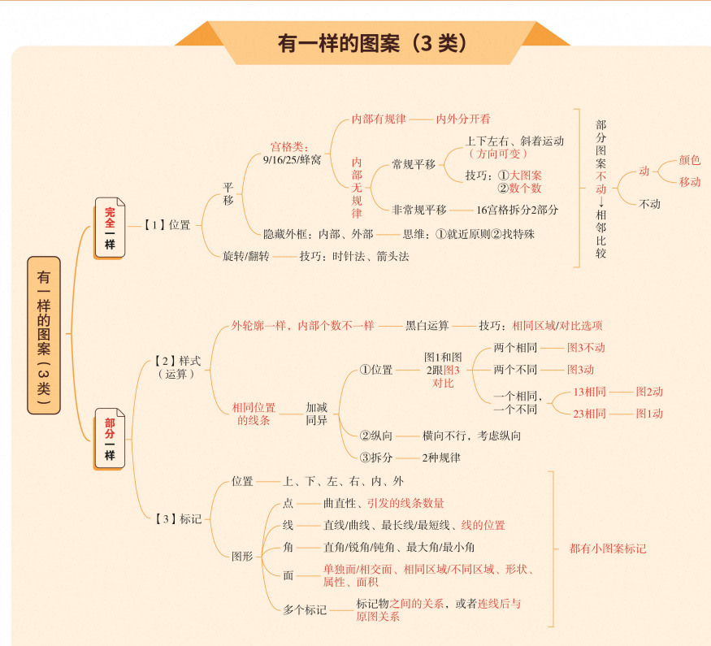

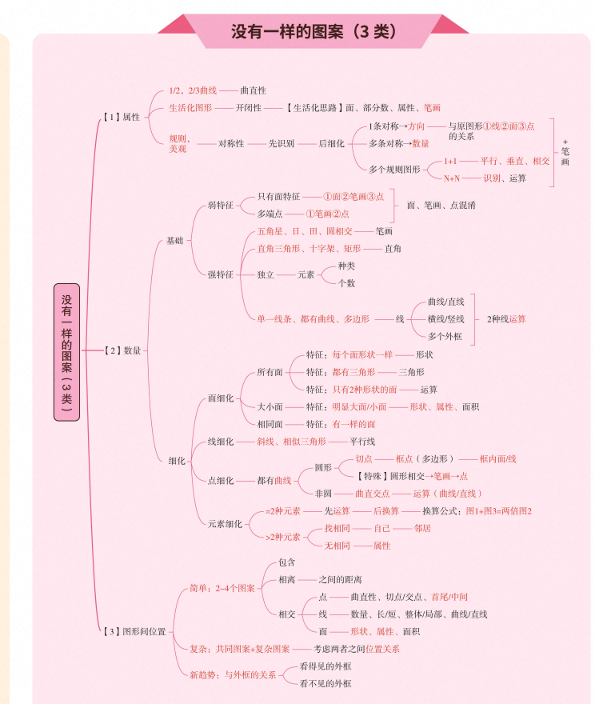

---

## 第一部分 · 位置规律（第一课）

### 串讲总结（总纲）

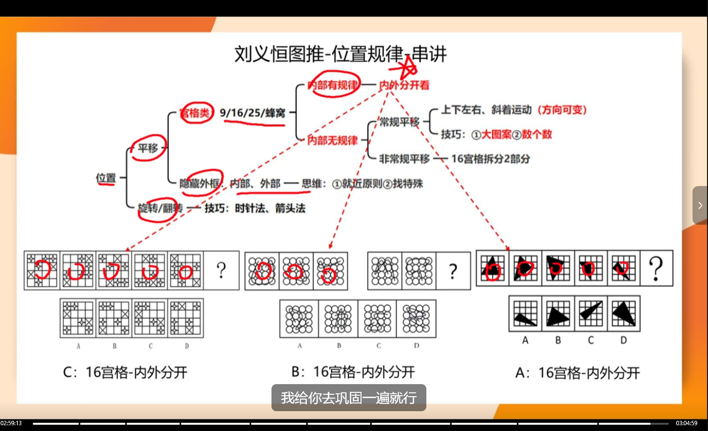

位置规律全图（第一课）：

- **宫格类**（9 / 16 / 25 / 蜂窝）
  - 内部有规律 → **内外分开看**
  - 内部无规律 → 常规平移（上下左右、斜着运动，方向可变；技巧：① 大图案 ② 数个数）/ 非常规平移（16 宫格拆 2 部分）
- **平移**：隐藏外框、内部、外部——思维：① 就近原则 ② 找特殊
- **旋转 / 翻转**：技巧：时针法、箭头法
- 课上例题（A / B / C）答案均为"16 宫格 - 内外分开"

> 来源：超格刘义恒《图推命题思维》

### 位置规律 · 多宫格

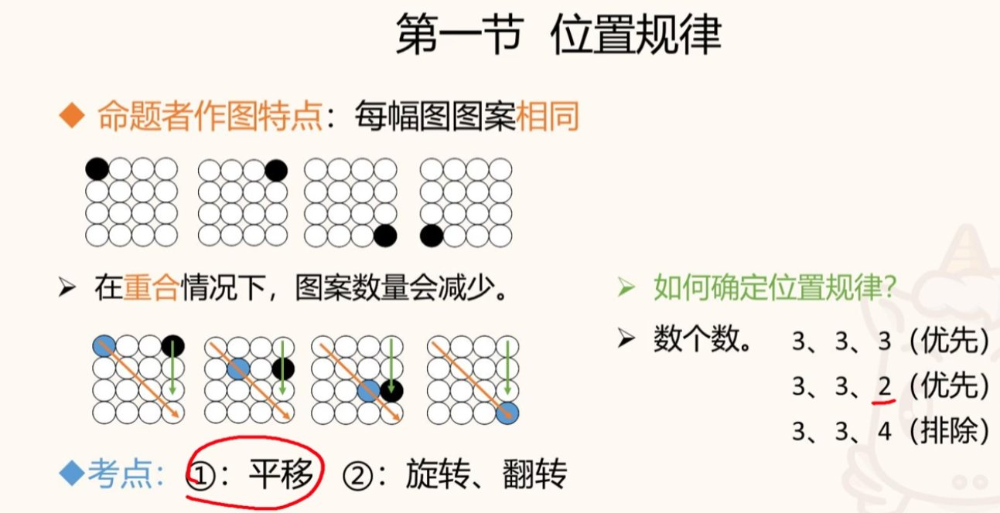

- **识别特征**：每幅图图案相同；图案重合时数量会减少
- **考点**：① 平移（多宫格常考）② 旋转、翻转
- **如何确定**：数个数——3、3、3（优先）；3、3、2（重合减少，优先）；3、3、4（排除，不是位置规律）

#### 平移 · 细化

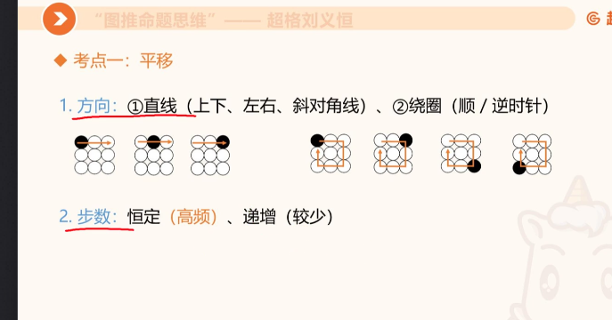

- **方向**：① 直线（上下、左右、斜对角线）② 绕圈（顺 / 逆时针）
- **步数**：恒定（高频）、递增（较少）

> 来源：超格刘义恒《图推命题思维》

### 旋转 / 翻转 · 时针法与箭头法

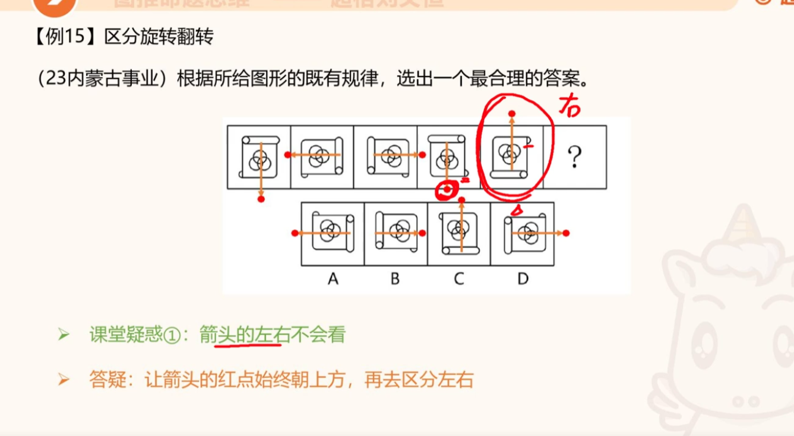

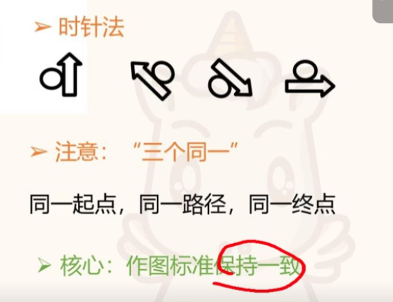

**例15 · 区分旋转翻转**（23 内蒙古事业）：

- **课堂疑惑**：箭头的左右不会看
- **答疑**：让箭头的红点始终朝上方，再去区分左右

**时针法**：

- **注意"三个同一"**：同一起点、同一路径、同一终点
- **核心**：作图标准保持一致

> 来源：超格刘义恒《图推命题思维》

### 破解出题者"小心思"

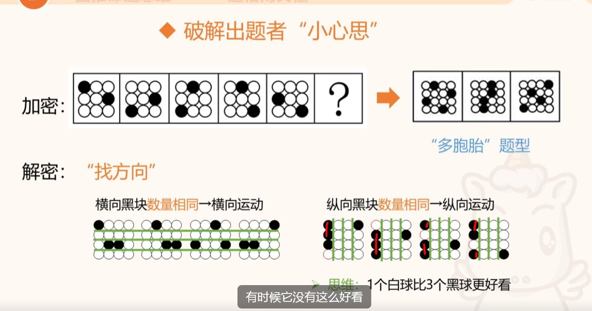

- **加密**：题干图案密集 → 答案也是"多胞胎"题型（同样密集）
- **解密 · 找方向**：横向黑块数量相同 → 横向运动；纵向黑块数量相同 → 纵向运动
- **思维**：1 个白球比 3 个黑球"更好看"（出题者偏好简洁图案）
- **心得**：黑球增加时，找方向很关键

#### 内外分开看 · 16 宫格

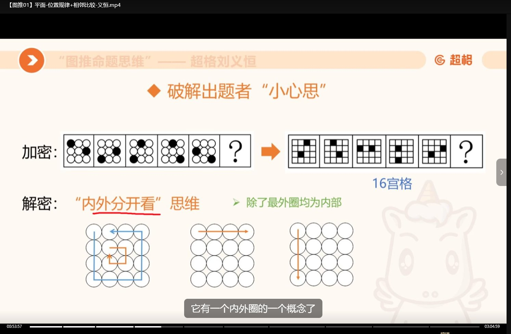

- **加密**：除了最外圈，其余均为"内部"——16 宫格有内、外、外圈的概念
- **解密**：把"内部"和"外圈"分开看，各自找运动规律（如内圈绕圈、外圈横行）

#### 线段平移 · 特殊线条与隐藏图形

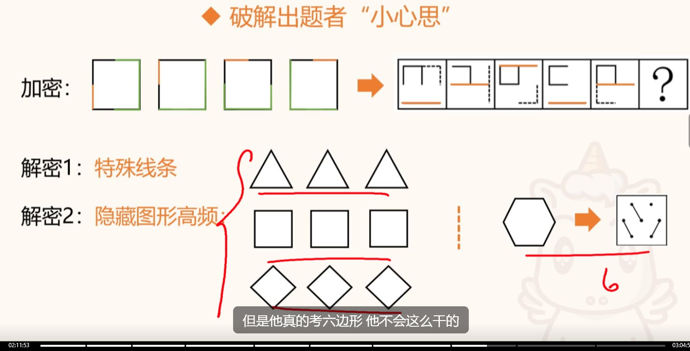

- **解密1 · 特殊线条**：同一种特殊线条重复出现（如 3 个三角形 = 同一线条反复用）
- **解密2 · 隐藏图形高频**：盯高频隐藏图形（如正方形、菱形各出现 3 次）
- **避坑**：出现六边形别直球当六边形做——出题者不会这么直白（"他真的考六边形，他不会这么干的"）

> 来源：超格刘义恒《图推命题思维》

---

## 第二部分 · 数量规律（一组图 / 两组图）

### 一组图 · 出题者喜好

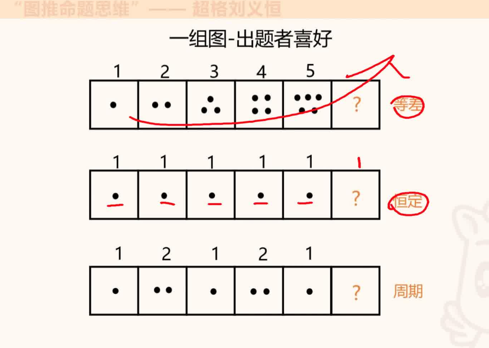

一组图（题干给一串图形，问"？"处）的三大经典考法：

- **等差**：元素数量逐幅递增 / 递减，如点数 1 → 2 → 3 → 4 → 5
- **恒定**：每幅图元素数量、样式完全相同，如点数恒为 1
- **周期**：元素数量交替循环出现，如点数 1 → 2 → 1 → 2 → 1

> 来源：超格刘义恒《图推命题思维》

### 两组图 · 出题者喜好

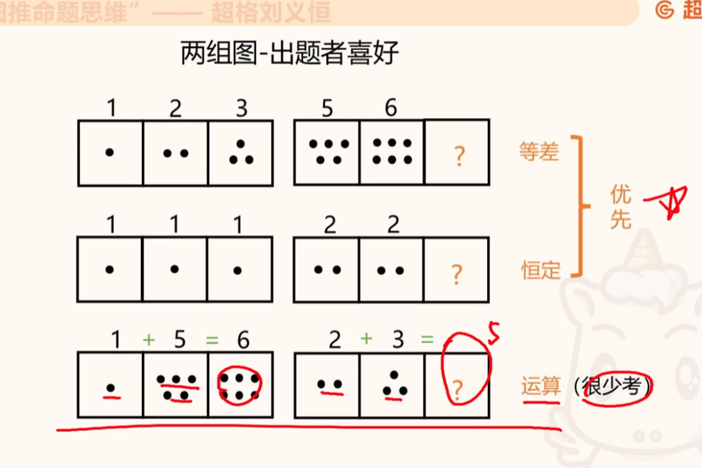

两组图（题干给两串图形，各自成组找规律）的三大经典考法：

- **等差**（优先）：每组内数量逐幅递增 / 递减，如 1 → 2 → 3、5 → 6 → 7
- **恒定**（优先）：每组内数量完全相同，如恒为 1、恒为 2
- **运算**（很少考）：每组内前两项运算得第三项，如 1 + 5 = 6、2 + 3 = 5

> 来源：超格刘义恒《图推命题思维》

---

## 第三部分 · 样式规律

### 串讲总纲（加减异同）

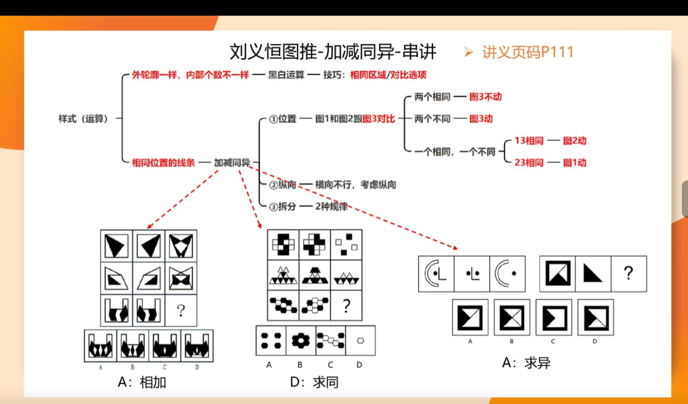

样式（运算）的两条线：

- **相同位置的线条** → **加减异同**（三条路径：① 位置——图1 和图2 跟图3 对比；② 纵向——横向不行，考虑纵向；③ 拆分——2 种规则）
- **外轮廓一样，内部个数不一样** → **黑白运算**（技巧：相同区域 / 对比选项）

> 来源：超格刘义恒《图推命题思维》

### 加减异同 · 三图谁不动的关键

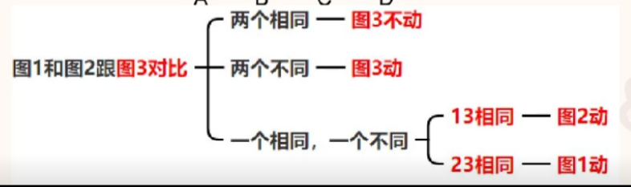

图1 和图2 跟图3 对比的决策树：

- **两个相同** → 图3 不动
- **两个不同** → 图3 动
- **一个相同、一个不同** → 1、3 相同则图2 动；2、3 相同则图1 动

> 来源：超格刘义恒《图推命题思维》

### 加减异同 · 谁不动 · 实战

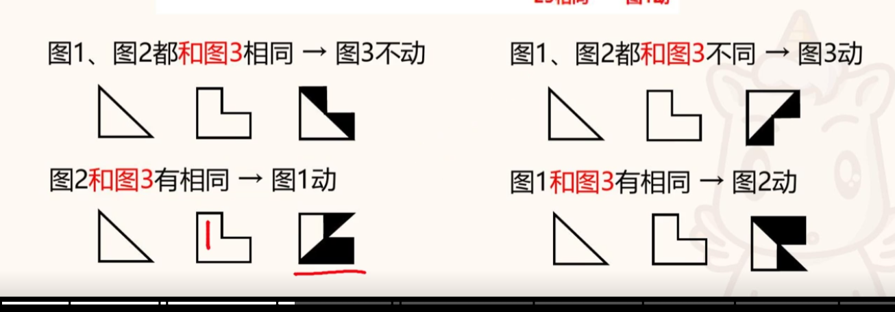

四条判定口诀：

- 图1、图2 都和图3 相同 → **图3 不动**
- 图1、图2 都和图3 不同 → **图3 动**
- 图2 和图3 有相同 → **图1 动**
- 图1 和图3 有相同 → **图2 动**

> 来源：超格刘义恒《图推命题思维》

### 黑白运算 · 提速技巧

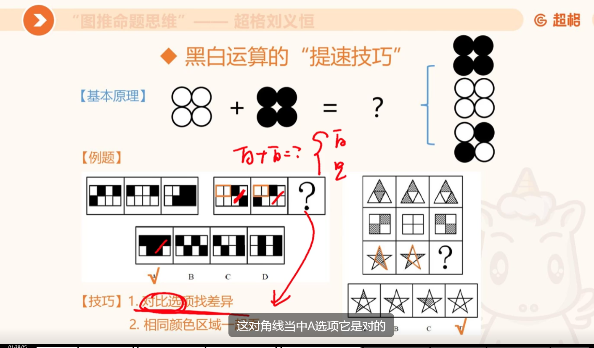

- **基本原理**：黑白两色相加定第三图（如 ○○ + ●● = ？）
- **技巧 1**：对比选项找差异
- **技巧 2**：相同颜色区域一起看

> 来源：超格刘义恒《图推命题思维》

