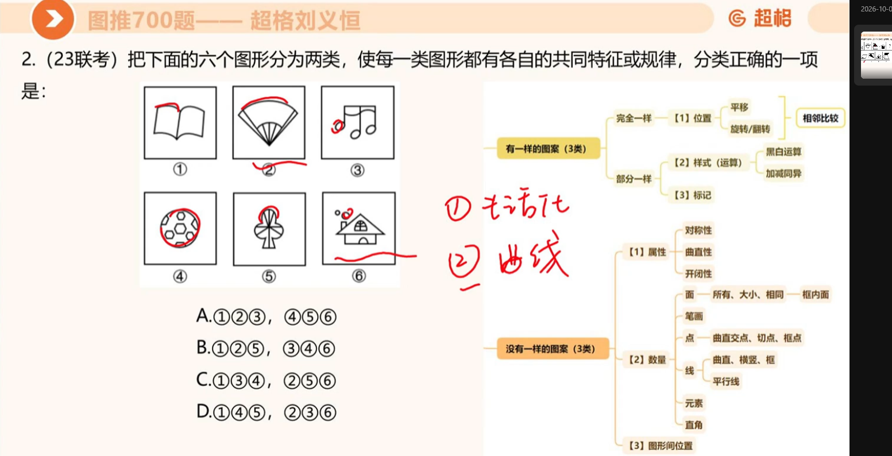
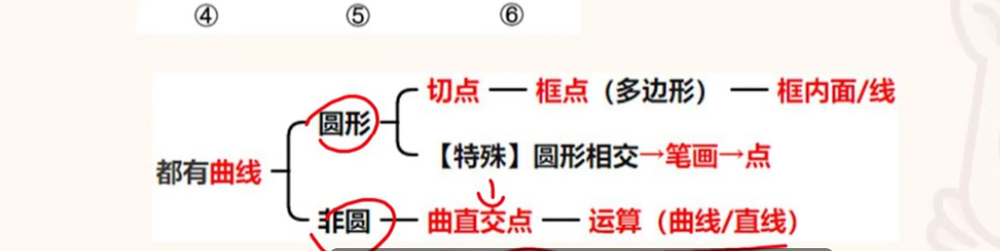
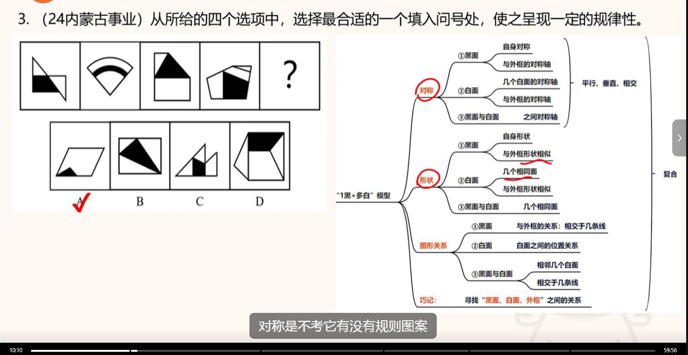
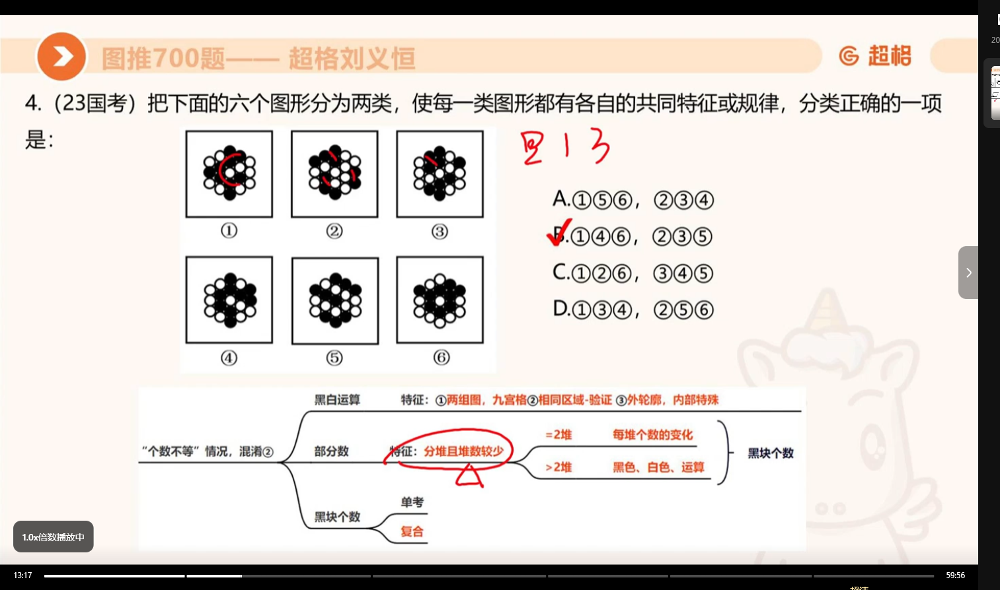

# 题目记录

> 本文件由 AI 维护：用户写入的题目，由 AI 负责整理记录。

## 目录

- [曲直相交 · 题目考点](#曲直相交--题目考点)（17、18 号图）
- [黑面与白面 · 题目考点](#黑面与白面--题目考点)（19 号图）
- [黑白"个树" · 题目考点](#黑白个树--题目考点)（20 号图）

## 曲直相交 · 题目考点

**题目**（图推700题 · 超格刘义恒 · 23联考第2题）：把六个图形分为两类，使每一类图形都有各自的共同特征或规律。

**考点 · 曲直相交**（都有曲线时，按"圆形 / 非圆"分两条线）：

- **圆形** → 切点、框点（多边形）→ 框内面 / 线；【特殊】圆形相交 → 笔画 → 点
- **非圆** → 曲直交点 → 运算（曲线 / 直线）

> 来源：图推700题 · 超格刘义恒（23联考第2题）

## 黑面与白面 · 题目考点

**题目**（图推700题 · 超格刘义恒 · 24内蒙古事业第3题）：从四个选项中选最合适的一个填入问号处，使之呈现一定的规律性（答案：A）。

**考点 · "1黑+多白"模型**（巧记：寻找"黑面、白面、外框"之间的关系）：

- **自身对称**：① 黑面 ② 白面 —— 与外框的对称轴
- **形状**：① 黑面 ② 白面 —— 与外框形状相似
- **图形关系**：① 黑面 ② 白面 —— 与外框的关系：相交于几条线

**心得**：黑面和白面的问题，相交于几条线是关键；对称不考图案有没有规则。

> 来源：图推700题 · 超格刘义恒（24内蒙古事业第3题）

## 黑白"个树" · 题目考点

**题目**（图推700题 · 超格刘义恒 · 23国考第4题）：把六个图形分为两类，使每一类图形都有各自的共同特征或规律（答案：B，①④⑥ / ②③⑤）。

**考点 · 黑白"个树"**：

- **部分数**（"个数不等"的混淆点；特征：分摊且堆数较少）：= 2 堆 → 每堆个数的变化；> 2 堆 → 黑色、白色、运算
- **黑块个数**：单考 / 复合
- **黑白运算**（特征：① 两组图 ② 九宫格 ③ 相同区域-验证 ④ 外轮廓、内部特殊）

> 来源：图推700题 · 超格刘义恒（23国考第4题）
