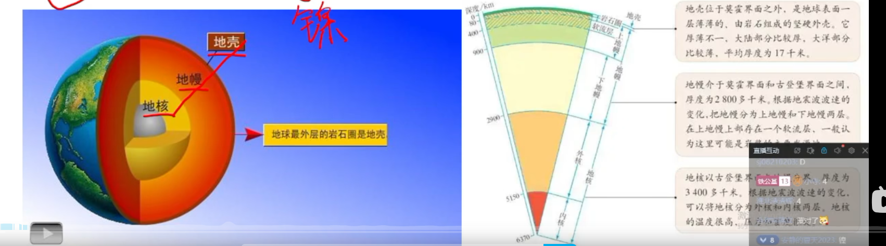

- 岩浆岩：花岗岩、玄武岩、流纹岩
- 沉积岩：石灰岩、页岩、砂岩、砾岩
- 变质岩：大理岩、石英岩

由于压强巨大，呈现为固态
的磁场就是这些液态金属围绕内地核流动而形成的

- 地壳：位于莫霍界面之外，是地球表面一层薄薄的、由岩石组成的坚硬外壳。它厚薄不一，大陆部分比较厚，大洋部分比较薄，平均厚度为 17 千米。

- 地幔：介于莫霍界面和古登堡界面之间，厚度为 2800 多千米。根据地震波波速的变化，把地幔分为上地幔和下地幔两层。在上地幔上部存在一个软流层，一般认为这里可能是岩浆的主要发源地。

- 地核：以古登堡界面为界，厚度为 3400 多千米。根据地震波波速的变化，可以将地核分为外核和内核两层。地核的温度很高，压强巨大，呈现为固态（外核为液态/熔融态）。

1. 地球圈层划分依据——地震波（地震波可分为纵波和横波，纵波传播快，横波传播慢，横波只能在固体中传播。）
   - 地球的外部圈层包括大气圈、水圈、生物圈等

2. 地球内部从外到内又分为三部分——地壳、地幔、地核

3. 主要元素含量顺序：氧、硅、铝、铁、钙