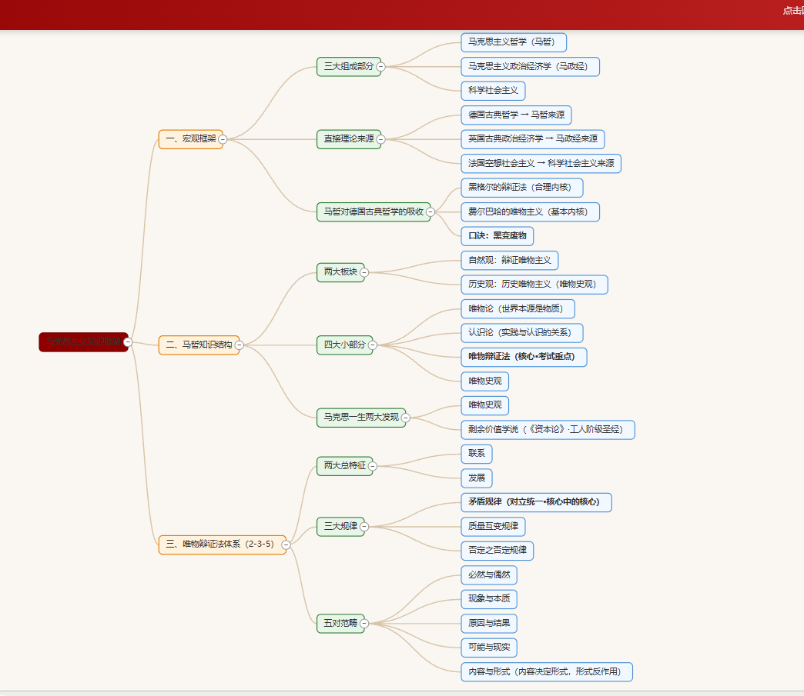
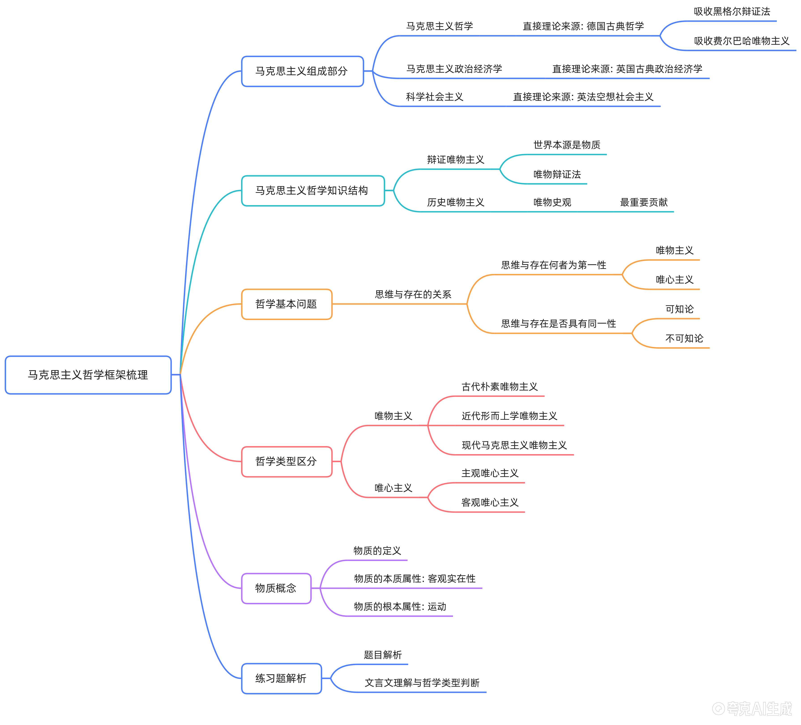

# 政治理论

> 公考政治理论（理论 + 时政）笔记。五个专题 + 一张易错总表 + 马原框架图。
> 用法：先看专题正文建立框架，考前只刷 §六 易错表和每节末尾的「速记」。
> 各节里出现「见 §x」表示该考点已在别处讲透，此处只留结论，不重复展开。

## 目录

1. “十五五”时期：重大意义与形势判断
2. 新时代就业工作规律：九个坚持
3. 新发展格局
4. 区域协调发展与新型城镇化
5. 新时代强军兴军
6. 易错辨析总表
7. 马原框架图

---

## 一、“十五五”时期：重大意义与形势判断

### （一）第一个深刻领会：重大意义

**1. 党的鲜明特点和独特优势**

- 按照经济社会发展规律确定奋斗目标 —— 从实际出发。
- 一以贯之锚定奋斗目标团结奋进 —— 不中断、可持续。

**2. 阶梯式递进的历史过程**

- 实现社会主义现代化，是阶梯式递进、不断发展进步的过程。
- **两个大阶梯**：
  - 2035 年 —— 基本实现社会主义现代化。
  - 本世纪中叶 —— 全面建成社会主义现代化强国。
- **小阶梯**：一个五年规划。因此“十五五”正处在两个大阶梯之间。

**3. “十五五”的定位：承前启后**

| 维度 | 内容 |
| --- | --- |
| 承前 | 承接全面建成小康社会（十四五时期） |
| 启后 | 开启基本实现社会主义现代化（十六五时期） |

**4. 抓好“十五五”的四个重大深远意义**

1. 实现党的二十大描绘的宏伟蓝图 —— 全面建成社会主义现代化强国、以中国式现代化全面推进中华民族伟大复兴，分阶段有步骤推进中国式现代化。
2. 有效应对复杂严峻的外部环境新变化 —— 不稳定不确定因素增多，在激烈国际竞争中赢得战略主动（科技、产业、市场、规则等领域的竞争主导权）。
3. 适应我国发展阶段性要求，深入推动高质量发展。
4. 为基本实现社会主义现代化奠定更加坚实的基础。

### （二）第二个深刻领会：国内外形势的基本判断

- **前提**：科学决策的前提是正确判断形势。
- **基本判断**：我国发展处于**战略机遇和风险挑战并存、不确定难预料因素增多**的时期。
  - 既有利因素（战略机遇），也有不利因素（风险挑战）。
  - 不确定难预料因素举例：地区冲突是否升级、个别国家关税与技术封锁、人工智能发展程度及其风险。
- **应对策略**：集中力量办好自己的事 —— 增强自身实力，降低外界变化的影响力。
- **行动要求**：全党把思想和行动统一到党中央这一基本判断和重大决策部署上来。
- **心态**：既保持战略定力、坚定必胜信心，又居安思危、增强忧患意识，始终保持战略主动。

**识变 — 应变 — 求变**

| 提法 | 含义 |
| --- | --- |
| 识变 | 及时发现变化 |
| 应变 | 主动采取措施解决问题 |
| 求变 | 通过改革创新来发展新优势 |

> **速记**：判断是“机遇与挑战并存、不确定难预料增多”；打法是“办好自己的事”；三步是“识变、应变、求变”；心态是“定力 + 忧患”。

---

## 二、新时代就业工作规律：九个坚持

1. 坚持**党**对就业工作的全面领导。
2. 坚持把**就业**作为民生之本。
3. 坚持实施**就业优先**战略。
4. 坚持依靠**发展**促进就业。
5. 坚持**扩大就业容量**和**提升就业质量**相结合。
6. 坚持突出抓好**重点群体**就业。
7. 坚持**创业**带动就业。
8. 坚持营造**公平就业环境**。
9. 坚持构建**和谐劳动关系**（等）。

> 记忆锚点：领导（党）→ 地位（民生之本）→ 战略（就业优先）→ 路径（发展、创业）→ 数量与质量 → 对象（重点群体）→ 环境 → 关系。

---

## 三、新发展格局

### （一）基本内涵

- **提出时间**：2020 年 4 月，中央财经委员会第七次会议首次提出。
- **核心表述**：构建以**国内大循环为主体**、**国内国际双循环相互促进**的新发展格局。

### （二）性质定位

- 是**把握未来发展主动权的战略性布局和先手棋**，是**长期的战略任务**。
- 是**开放的**国内国际双循环 —— 不是封闭的国内单循环，不是关起门来搞建设。

### （三）最本质特征

- **实现高水平的自立自强**（最本质特征）。
- 与之配套的两个定位：**关键**在经济循环的畅通无阻；**最紧迫**的是科技自立自强（突破“卡脖子”问题）。

### （四）关键路径与举措

1. **扩大内需**是战略基点 —— 把实施扩大内需战略同深化供给侧结构性改革有机结合。
2. **科技创新**是根本动力 —— 强化国家战略科技力量。
3. **全面深化改革** —— 打通堵点，形成**全国统一大市场**，破除地方保护与市场分割。
4. **推动高水平对外开放** —— 以国内大循环吸引全球资源，国内国际双循环相互促进。
5. **实体经济**是根基 —— 制造强国、产业链供应链韧性。

### （五）与高质量发展的关系

- 构建新发展格局，是**推动高质量发展的战略基点**。
- 高质量发展，是**全面建设社会主义现代化国家的首要任务**。

> **速记**：一个主体（国内大循环）、两个循环、一个本质特征（高水平自立自强）、一个战略基点（内需）、非权宜、非小循环。

---

## 四、区域协调发展与新型城镇化

我国区域发展战略 = **四大板块** + **区域重大战略** + **主体功能区** + **新型城镇化**，四根支柱。

### （一）四大板块（基础板块）

| 区域 | 官方标准表述 | 备注 |
| --- | --- | --- |
| 西部 | 推动西部大开发**形成新格局** | “率先”不是西部的表述 |
| 东北 | 推动东北**全面振兴** | — |
| 中部 | 促进中部地区**加快崛起** | — |
| 东部 | 鼓励东部地区**加快推进现代化** | “率先”是东部专属 |

### （二）区域重大战略（增长极）

1. **京津冀协同发展** —— 核心是疏解北京非首都功能；雄安新区是北京非首都功能疏解的集中承载地。
2. **长江经济带发展** —— 共抓**大保护**，不搞大开发（生态优先、绿色发展）。
3. **粤港澳大湾区建设** —— 打造国际一流湾区和世界级城市群。
4. **长三角一体化发展** —— 全国发展强劲活跃增长极、高质量发展样板区。
5. **黄河流域生态保护和高质量发展** —— 重在保护、要在治理。
6. **成渝地区双城经济圈** —— 带动全国高质量发展的重要增长极和新的动力源。

### （三）主体功能区战略

- **制度核心**：健全主体功能区制度，优化国土空间发展格局。
- **三类主体功能区**（三大空间格局）：

| 类型 | 功能定位 | 提供产品 |
| --- | --- | --- |
| 城市化地区 | 承载经济密集、人口集聚 | 工业品和服务产品 |
| 农产品主产区 | 保障农产品供给 | 农产品 |
| 生态功能区 | 保障生态安全 | 生态产品 |

- **要求**：不同区域按主体功能定位发展，形成优势互补、高质量发展的区域经济布局。

### （四）新型城镇化

**1. 核心与首要任务**

- **核心**：**以人为本**（不是以地为本，不是造城运动）。
- **首要任务**：把**有能力在城镇稳定就业和生活的常住人口有序实现市民化**（即农业转移人口市民化）。
  - 目标：农业转移人口在**户籍、教育、医疗、住房**等方面享有与城镇居民同等权利。

**2. 载体与形态**

- **重要载体**：以**县城**为重要载体的城镇化建设。
- **空间形态**：以**城市群、都市圈**为依托，构建大中小城市协调发展格局。
  - 城市群：京津冀、长三角、珠三角、成渝等。
  - 都市圈：大城市辐射带动周边中小城市。

**3. 城乡融合发展**

- **新型城乡关系**：工农互促、城乡互补、协调发展、共同繁荣。
- 全面实施**乡村振兴战略**，坚持农业农村优先发展，畅通城乡要素双向流动。

> **口诀**：东部率先西新格局，东北振兴中崛起；城镇化以人为核心，市民化是首要任务；县城载体都市圈，三大主体功能区；京津冀疏解非首都，长江保护不开发。

---

## 五、新时代强军兴军

### （一）强军目标与时间表

- **强军目标**：建设一支**听党指挥、能打胜仗、作风优良**的人民军队。

| 要素 | 定位 | 含义 |
| --- | --- | --- |
| 听党指挥 | **灵魂** | 决定军队建设的政治方向 |
| 能打胜仗 | **核心** | 反映军队的根本职能和军队建设的根本指向 |
| 作风优良 | **保证** | 关系军队的性质、宗旨、本色 |

- **三步走**：
  - 2027 年 —— 实现建军一百年奋斗目标。
  - 2035 年 —— 基本实现国防和军队现代化。
  - 本世纪中叶 —— 全面建成世界一流军队。

### （二）习近平强军思想（“十一个明确”）

1. 明确党对军队的绝对领导是人民军队**建军之本、强军之魂**。
2. 明确强国必须强军 —— 巩固国防和强大人民军队，是新时代坚持和发展中国特色社会主义、实现中华民族伟大复兴的战略支撑。
3. 明确党在新时代的强军目标 —— 即上文“听党指挥、能打胜仗、作风优良”（见 §五·一）。
4. 明确军队必须聚焦**能打仗、打胜仗**（战斗力标准）。
5. 明确**创新**是引领发展的第一动力，推进科技强军。
6. 明确**改革**是强军的必由之路，推进改革强军。
7. 明确**政治建军**是我军立军之本，推进政治建军。
8. 明确**人才**是推动我军高质量发展、赢得军事竞争和未来战争主动的关键因素，推进人才强军。
9. 明确**依法治军**是我们党建军治军的基本方式，推进依法治军。
10. 明确**军民融合发展**是兴国之举、强军之策。
11. 明确**作风优良**是我军鲜明特色和政治优势，必须全面从严治党、全面从严治军。

### （三）五大建军布局

| 布局 | 定位 |
| --- | --- |
| 政治建军 | **立军之本**（党对军队绝对领导是强军之魂、建军之本） |
| 改革强军 | 必由之路 / 关键一招 |
| 科技强军 | 核心战斗力 / 核心驱动力 |
| 人才强军 | 第一资源 |
| 依法治军 | 基本方式 / 重要依托 |

### （四）人民军队的使命任务（四个战略支撑）

1. **为巩固中国共产党领导和我国社会主义制度提供战略支撑**（首要支撑）。
2. 为捍卫国家主权、统一、领土完整提供战略支撑。
3. 为维护我国海外利益提供战略支撑。
4. 为促进世界和平与发展提供战略支撑。

### （五）建设标准与人才培养

- **唯一的根本的标准**：**战斗力**（全部工作向能打仗、打胜仗聚焦）。
- **新时代革命军人培养目标（四有）**：有灵魂、有本事、有血性、有品德。
- **军队好干部标准**：对党忠诚、善谋打仗、敢于担当、实绩突出、清正廉洁。

### （六）党对军队绝对领导的历史脉络

| 阶段 | 事件 | 内容 |
| --- | --- | --- |
| 发端 | 南昌起义（1927.8.1） | 打响武装反抗第一枪 |
| 奠基 | 三湾改编（1927.9） | 支部建在连上 |
| 定型 | 古田会议（1929.12） | 确立思想建党、政治建军原则 |

- 2014 年新古田会议 —— 提出新时代政治建军方略。
- **根本制度**：军委主席负责制，是坚持党对军队绝对领导的根本制度和根本实现形式。

### （七）国防和军队改革

1. **领导指挥体制改革** —— 军委管总、战区主战、军种主建。
2. **规模结构和力量编成改革** —— 精简数量、优化结构，打造精锐作战力量。
3. **军事政策制度改革** —— 重塑中国特色社会主义军事政策制度体系。

> **速记**：一个目标（听党指挥、能打胜仗、作风优良）、五大布局、四个支撑、四有军人、唯一标准（战斗力）、政治建军是立军之本。

---

## 六、易错辨析总表

> 各专题正文已去掉零散的“易错提醒”，全部收敛到这张表。考前只刷这张表。

| 模块 | 错误表述 | 正确表述 |
| --- | --- | --- |
| 新发展格局 | 以国际大循环为主体 | 以**国内大循环**为主体 |
| 新发展格局 | 权宜之计 / 被动应对 | 主动的战略选择、**长期的战略任务** |
| 新发展格局 | 双循环就是内外脱钩、闭关锁国 | 是**更开放的**国内国际双循环 |
| 新发展格局 | 各地搞自我小循环、自成体系 | 打通堵点，建设**全国统一大市场**，破除地方保护与市场分割 |
| 新发展格局 | 最本质特征是“畅通无阻”或“科技自立自强” | 最本质特征 = **高水平自立自强**；畅通是“关键”，科技自立自强是“最紧迫” |
| 区域协调 | 西部大开发率先推进现代化 | **东部**“加快推进现代化（率先）”，**西部**“形成新格局” |
| 区域协调 | 长江经济带搞大开发 | **共抓大保护，不搞大开发** |
| 区域协调 | 主体功能区只有两类 | **城市化地区、农产品主产区、生态功能区**三类 |
| 新型城镇化 | 首要任务是土地城镇化 / 城市建设 | 首要任务是**农业转移人口市民化** |
| 新型城镇化 | 以地市 / 省城为重要载体 | 以**县城**为重要载体 |
| 新型城镇化 | 核心是以地为本、造城运动 | 核心是**以人为本** |
| 强军 | 依法治军是立军之本 | **政治建军**是立军之本；依法治军是**基本方式** |
| 强军 | 战斗力是重要标准之一 | 战斗力是**唯一的、根本的**标准 |
| 强军 | 军队使命只是保家卫国 | **四个战略支撑**（党的领导与社会主义制度、主权统一领土完整、海外利益、世界和平） |
| 强军 | 四有 = 有理想、有道德…… | **有灵魂、有本事、有血性、有品德** |
| 强军 | 党对军队绝对领导定型于南昌起义 | 发端**南昌**、奠基**三湾**、定型**古田** |

---

## 七、马原框架图

两张思维导图是同一个体系的不同切法，配合看：第一张偏“考点骨架”（三大规律、五对范畴），第二张偏“概念辨析”（哲学基本问题、哲学类型、物质概念）。

**图 1 —— 马原总体框架（三大部分 → 两大板块 → 四大部分 → 三大规律 → 五对范畴）**

**图 2 —— 马原哲学框架梳理（组成部分 → 知识结构 → 哲学基本问题 → 哲学类型 → 物质概念）**

