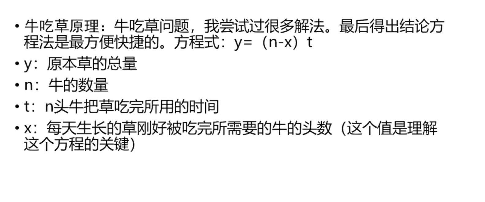
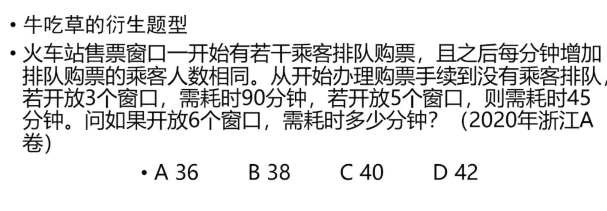
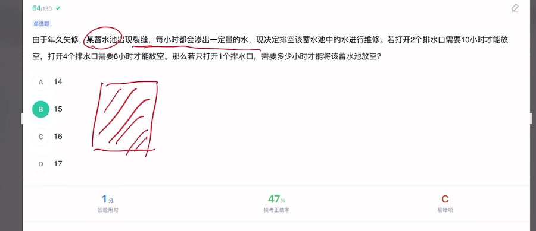
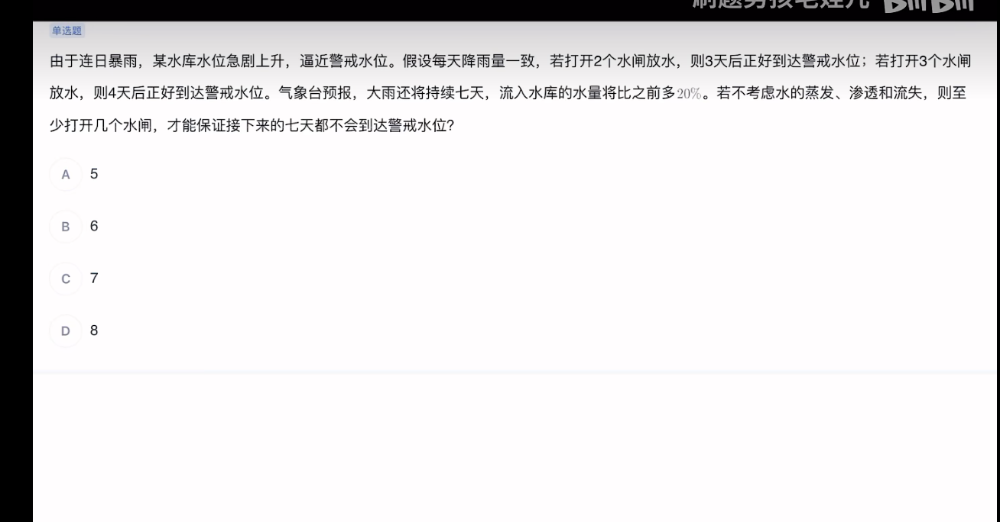
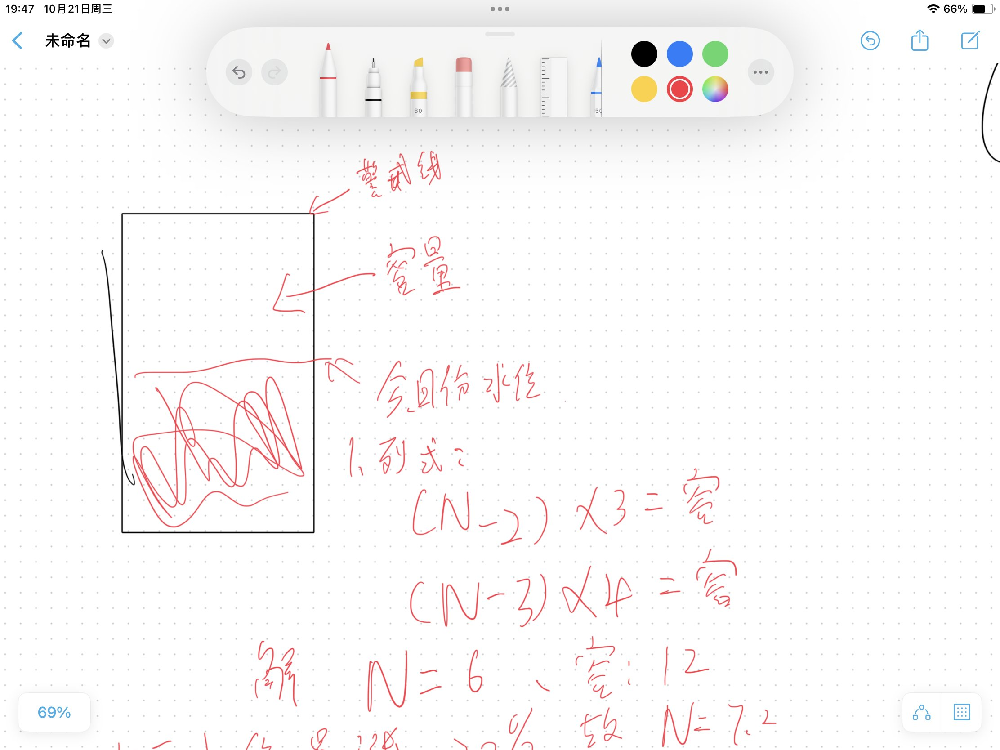
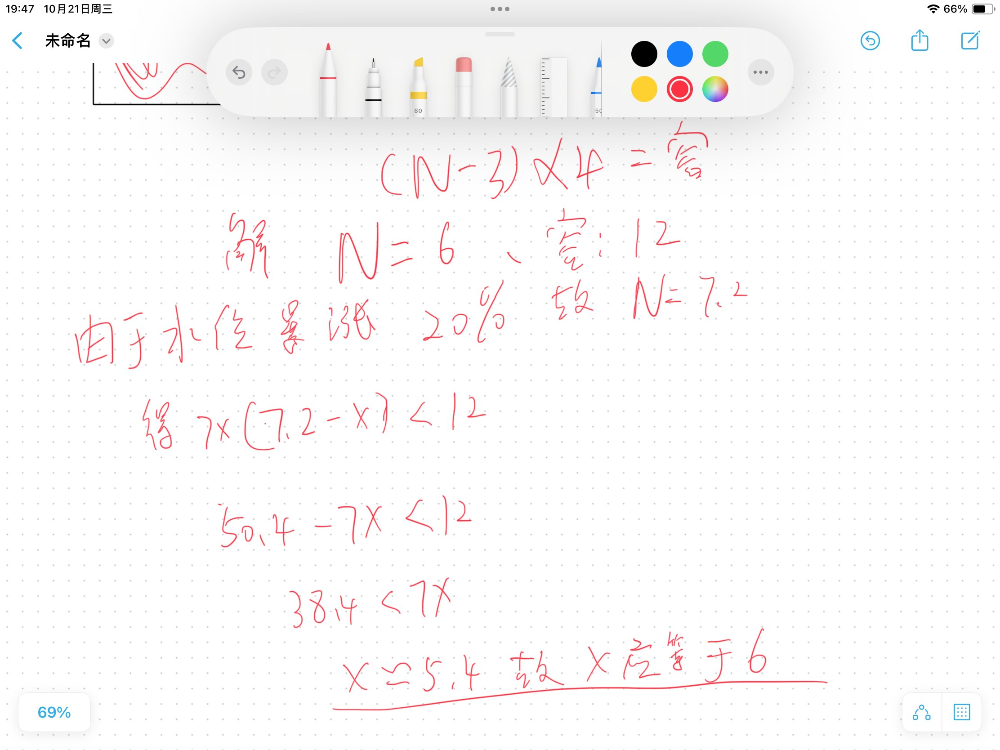

# 牛吃草问题（含衍生题型）总结

> 一句话核心：**有一堆东西在变多，有几组"工作者"在消耗它，求何时消耗完。**
> 公式只有一个：`y = (n - x) t`，其余全是它的变形和比值。
>
> ⚠️ **排版约定**：本文件所有公式都用纯文本书写（`÷`、`×`、`−`），不使用 LaTeX 的 `$$` / `\frac`。用 Typora、VS Code、Obsidian、GitCode 预览都能直接看见，不会出现红字或空白。

---

## 一、题型识别

| 标志 | 说明 |
|---|---|
| 有"生长/流入/新来"的增量 | 草在长、水在进、乘客在来、车辆在到 |
| 有"消耗者" | 牛、窗口、抽水机、检票口、收银台 |
| 给两组"数量 × 时间" | 5 人 8 天 / 4 人 12 天 |

**伪装成"工程问题""反比问题"的都是同一类**，看到"总量在变 + 两组数据"就往牛吃草上套。

---

## 二、核心公式

### 标准式

> **y = (n − x) × t**

> 📷 **参考资料截图（牛吃草原理）**



| 符号 | 含义 | 易错理解 |
|---|---|---|
| **y** | 原有量（原有草量 / 原有人数） | 不是总消耗量 |
| **n** | 消耗者数量（牛数 / 窗口数 / 人数） | 不是净速度 |
| **x** | **每天（每分钟）新增的量，刚好够 x 个消耗者用** | 单位是"个数"，不是"份/天" |
| **t** | 用完所需时间 | — |

### 等价展开式（考试常用）

> **n × t = y + x × t**　　（即 **y = t × (n − x)**）

两种写法本质相同，`y = (n − x) × t` 更好用——**x 和 n 同单位**，可以直接相减。

**关键理解（必须记牢）**：
> n 个消耗者里，有 x 个只是在吃"新长出来的部分"，真正在吃"原有量"的只有 **(n − x)** 个。
> 所以：**净消耗者数量 × 时间 = 原有量（常数）**。

---

## 三、解题四步

```
第 1 步  设 y = (n - x)t，x = 新增量相当于几个消耗者
第 2 步  两组条件联立，解出 x
第 3 步  代回任一组，求 y
第 4 步  t = y / (n' - x) 求目标
```

### 步骤 2 的速算：两式相等，直接约

> **(n₁ − x) × t₁ = (n₂ − x) × t₂**

展开移项得到速算式：

> **x = (n₂t₂ − n₁t₁) ÷ (t₂ − t₁)**

就是"**总量差 ÷ 时间差**"。

> 直观意义：**两组总消耗量之差 ÷ 时间差 = 每天新增量**。多拖的那些天里，多出来的消耗量全是新长出来的。

---

## 四、倒数法（比值版，秒杀用）

### 原理

由 y = (n − x) × t 两边同除以 t：

> **(n − x) ÷ y = 1 ÷ t**

两组条件相比（y 约掉）：

> **t₁ ÷ t₂ = (n₂ − x) ÷ (n₁ − x)**

**当 y 固定时，净消耗者数量与时间成反比。** 因为 y 在比值里被约掉，所以可以**不必求 y**，直接用比例推进。

### 正确表述（血泪教训）

| 说法 | 对错 |
|---|---|
| 牛的数量与时间成反比 | ❌ 只适用于 x=0（不长）的场景 |
| **净值 (n − x) 与时间成反比** | ✅ 这才是倒数法 |
| 倒数法不适用于牛吃草 | ❌ 完全适用，只需先减掉 x |

### 操作

1. 看两组时间，化简成整齐比例（如 90:45 = 2:1）
2. 列：**(n₂ − x) ÷ (n₁ − x) = t₁ ÷ t₂**，解出 x
3. 再列：**t₃ ÷ t₁ = (n₁ − x) ÷ (n₃ − x)**，直接求 t₃，**不用求 y**

---

## 五、例题精讲


*（原理卡片再贴一次，便于对照例题中 y、n、x、t 各代表什么）*

---

### 例 1（本站主例题）：工人除草

> 某块农田野草生长过盛，需进行除草，若生长速度不变，则 5 名工人需工作 8 天能除完野草，4 名工人需工作 12 天能除完，那么 3 名工人需工作（ ）天方能完成除草？
> A. 18　B. 24　C. 30　D. 36

**解 1：原公式法**

设 1 人 1 天除 1 份，草每天长 x 份（即够 x 个人除）。

- ① 5 人 × 8 天 = 40 份 = **y + 8x**
- ② 4 人 × 12 天 = 48 份 = **y + 12x**

② − ①：48 − 40 = 4x → **x = 2**（草每天长的量 ≈ 2 个人的工作量）

代回①：y = 40 − 8 × 2 = **24**（原有野草 24 份）

3 人时净除草速度 = 3 − 2 = 1，所以：

- 时间 t = 原有草 ÷ 净速度 = 24 ÷ 1 = **24 天**

**解 2：倒数法**

- 第一步，求 x： (4 − x) ÷ (5 − x) = 8 ÷ 12 = 2/3
  → 12 − 3x = 10 − 2x → **x = 2**
- 第二步，求 3 人时间：t₃ ÷ 8 = (5 − 2) ÷ (3 − 2) = 3
  → t₃ = 8 × 3 = **24 天**
- （也可用 4 人那组：t₃ ÷ 12 = (4 − 2) ÷ (3 − 2) = 2 → t₃ = 24 天）

**答案：B（24 天）**

---

### 例 2（衍生题型）：火车站售票窗口 —— 2020 浙江 A 卷

> 📷 **原题截图**



> 火车站售票窗口一开始有若干乘客排队购票，且之后每分钟增加排队购票的乘客人数相同。从开始办理购票手续到没有乘客排队，若开放 3 个窗口，需耗时 90 分钟；若开放 5 个窗口，则需耗时 45 分钟。问如果开放 6 个窗口，需耗时多少分钟？
> A. 36　B. 38　C. 40　D. 42

**映射关系**：

| 牛吃草 | 本题 |
|---|---|
| 牛数 n | 窗口数 |
| 原有草 y | 初始排队人数 |
| 草长速度 x | 每分钟新到人数 ≈ x 个窗口的办理量 |
| 天数 t | 分钟数 |

**解 1：原公式法**

设每窗口每分钟办 1 人，每分钟新来的人够 x 个窗口办：

- ① 3 窗口 90 分钟：y = (3 − x) × 90
- ② 5 窗口 45 分钟：y = (5 − x) × 45

① = ②，两边同除以 45：

- 2 × (3 − x) = 5 − x
- 6 − 2x = 5 − x
- **x = 1**

代回①：y = (3 − 1) × 90 = **180 人**（初始排队 180 人）

6 个窗口时：

- 时间 t = 180 ÷ (6 − 1) = **36 分钟**

**解 2：倒数法（两轮比值，不求 y）**

- 第一轮：时间比 45 : 90 = 1 : 2 → 净窗口数比 (5 − x) : (3 − x) = 2 : 1
  → 5 − x = 6 − 2x → **x = 1**
- 第二轮：t₃ : t₁ = (3 − x) : (6 − x) = 2 : 5
  → t₃ = 90 × 2/5 = **36 分钟**

**验算**：3×90 − 1×90 = 180，5×45 − 1×45 = 180，6×36 − 1×36 = 180 ✓ 三组自洽

**答案：A（36 分钟）**

**干扰项来源**：
- 直接把 3×90 = 270、5×45 = 225 当总工作量、按"总量不变"反推 → 得到 38~42 之间，正好覆盖 B/C/D
- 只要先求出 x = 1，答案必然是 180 ÷ 5 = 36

---

### 例 3（对照练习）：标准牛吃草

> 一片草场，27 头牛 6 天吃完，23 头牛 9 天吃完，问 21 头牛几天吃完？

**解**：

- ① 27 × 6 = 162 = y + 6x
- ② 23 × 9 = 207 = y + 9x

② − ①：45 = 3x → **x = 15**（每天新长的草够 15 头牛吃）

代回①：y = 162 − 90 = **72**

- 时间 t = 72 ÷ (21 − 15) = **12 天**

**验算**：21 × 12 = 252，72 + 15 × 12 = 252 ✓

**倒数法同解**：

- (27 − x) ÷ (23 − x) = 9 ÷ 6 = 3/2 → 54 − 2x = 69 − 3x → x = 15
- t₃ ÷ 6 = (27 − 15) ÷ (21 − 15) = 12 ÷ 6 = 2 → t₃ = **12 天** ✓

---

### 例 4（反向变式）：蓄水池漏水 —— 本题选 B（15 小时）

> 📷 **原题截图**



> 由于年久失修，某蓄水池出现裂缝，每小时都会渗出一“定量的水”，现决定排空该蓄水池中的水进行维修。若打开 2 个排水口需要 10 小时才能放空，打开 4 个排水口需要 6 小时才能放空。那么若只打开 1 个排水口，需要多少小时才能将该蓄水池放空？
> A. 14　B. 15　C. 16　D. 17

**为什么叫"反向"**

前面几道题里，新增量是**帮忙的**：草长出来会让净消耗速度变小（减）；
这道题里，裂缝渗水是**帮倒忙的**：它让需要排掉的水变多，所以排水速度按"慢的算"，即不减反加：

| | 草在长（正题） | 裂缝渗水（本题） |
|---|---|---|
| 原有量 y | 原有草量 | 池中原水量 |
| 消耗者 n | 牛数 | 排水口数 |
| 新增 x | 每小时长出的草 | 每小时渗进来的水 |
| 净速度 | **n − x**（x 让牛少吃原有草） | **n + x**（x 让排水口多排） |
| 公式 | y = (n − x) × t | **y = (n + x) × t** |

**关键：先判断 x 是"帮忙"还是"帮倒忙"，决定公式里是减号还是加号。**

**解 1：原公式法（加号版）**

设每口每小时排水 1 份，裂缝每小时渗入 x 份（即够 x 个排水口排掉）。

- ① 2 口 × 10 小时：原水量 y = (2 + x) × 10
- ② 4 口 × 6 小时：原水量 y = (4 + x) × 6

① = ②：

- 20 + 10x = 24 + 6x
- 10x − 6x = 24 − 20
- 4x = 4 → **x = 1**

代回①：y = (2 + 1) × 10 = **30 份**

1 个排水口时：

- 时间 t = y ÷ (n + x) = 30 ÷ (1 + 1) = **15 小时**

**解 2：倒数法（净速度改成 n + x）**

y 固定时，净速度与时间成反比：

- 第一步求 x：时间比 t₁ : t₂ = 10 : 6 = 5 : 3，所以净速度比为 3 : 5
  → (2 + x) : (4 + x) = 3 : 5
  → 5 × (2 + x) = 3 × (4 + x) → 10 + 5x = 12 + 3x → 2x = 2 → **x = 1**
- 第二步求 t₃：t₁ : t₃ = (1 + x) : (2 + x) = 2 : 3
  → 10 : t₃ = 2 : 3 → t₃ = 10 × 3 ÷ 2 = **15 小时**

**验算（三组代入 y 必须相同）**：

- (2 + 1) × 10 = 30 ✓
- (4 + 1) × 6 = 30 ✓
- (1 + 1) × 15 = 30 ✓

**答案：B（15 小时）**

> 📌 **与你截图里的区别**：截图中该题正确答案标的是 **B（15）**，与公式计算完全一致。
>
> ⚠️ **两个需要记住的陷阱**
>
> 1. **符号陷阱**：这题的 x 是"帮倒忙"的，净速度是 **n + x**。如果照抄正题写成 n − x，会解出负数或 y 为负——**负数就是"符号搞反"的报警器**。
> 2. **干扰项来历**：A 14、C 16、D 17 由"符号弄反/把渗水当正题处理"产生。正确值 15 是唯一能让三组条件都代回 y = 30 的数——**用验算就能把干扰项全筛掉**。

**倒数的竖式草算（考场速记版）**

```
2 口 10 时  →  (2 + x) × 10 = y
4 口 6 时   →  (4 + x) × 6  = y
比：10 : 6 = 5 : 3  →  (2+x) : (4+x) = 3 : 5  →  x = 1
y = 30；1 口 → 30 ÷ 2 = 15 时
```

---

### 例 5（"至少开几个"型）：水库放水保住警戒水位 —— B（6 个）

> 📷 **原题截图**



> 由于连日暴雨，某水库水位急剧上升，逼近警戒水位。假设每天降雨量一致，若打开 2 个水闸放水，则 3 天后正好到达警戒水位；若打开 3 个水闸放水，则 4 天后正好到达警戒水位。气象台预报，大雨还将持续七天，流入水库的水量将比之前多 20%。若不考虑水的蒸发、渗透和流失，则至少打开几个水闸，才能保证接下来的七天都不会到达警戒水位？
> A. 5　B. 6　C. 7　D. 8

**第一步：翻译成牛吃草**

| 牛吃草 | 本题 |
|---|---|
| 牛在吃（−n） | 水闸在放（−n），水位往下走 |
| 草在长（+x） | 雨在下（+x），水位往上走 |
| y = 原有草量，吃完为止 | **y = 容量（离警戒线还能装多少）**，涨满为止 |
| 公式 | 每天净涨 N − n，涨了 t 天：**(N − n) × t = 容量** |

**两个关键理解**

1. **"正好到达警戒水位" = 容量用完**：每天净涨量 × 天数 = 现在水位到警戒线的差。所以"2 个水闸 3 天"→ **(N − 2) × 3 = 容量**。
2. **口越多，到警戒线反而越晚**（2 口 3 天、3 口 4 天）——因为这里 **N（降雨 6）比水闸数还大**，净涨为正，多开一个口只是让涨得慢一点，并不能真的把水排下去。**这正是"牛吃草最长路径"的反直觉版本，看到这种数据别怀疑自己。**

**第二步：求降雨量 N 和离警戒线的容量**

> 📷 **笔记本手写推导（第一步：列式、解 N 和容量）**



设每天降雨 N 个单位（够放水 N 天），离警戒线还能装 **"容量"**。

- ① 开 2 个水闸 3 天：放掉 2×3 = 6，正好到警戒线
  → **"(N − 2) × 3 = 容量"**（每天净涨 N − 2，涨了 3 天）
- ② 开 3 个水闸 4 天：放掉 3×4 = 12
  → **"(N − 3) × 4 = 容量"**

两式相等：3N − 6 = 4N − 12 → **N = 6**（每天降雨够 6 个水闸的放水量）

代回①：容量 = (6 − 2) × 3 = **12**

> 这就是 **y = (n − x) × t** 的本体：y = 12 是"离警戒线的余量"，n = 水闸数，x = 降雨量 6。
> 注意这里 x（降雨）比 n（水闸）还大，所以 **(n − x) 是负数，天数越长余量反而涨得越快**——这正是"口多反而更晚到"的原因。

**第三步：套 20%，求"至少开几个"**

> 📷 **笔记本手写推导（第二步：7.2 代入、解出 x > 5.4 → 取 6）**



大雨持续 7 天，降雨量多 20%：

- **N' = 6 × 1.2 = 7.2**

要求：7 天里**不能把容量填满**，即 7 天的净涨量 < 容量：

- **7 × (7.2 − x) < 12**（这里 x = 要开的水闸数）
- 50.4 − 7x < 12
- 38.4 < 7x
- **x > 5.4857**

**取整：x 至少 = 6 → 选 B（6 个）**

**验算**：

- 6 个水闸：每天净涨 7.2 − 6 = 1.2，7 天涨 8.4 < 12 ✓ **安全**
- 5 个水闸：每天净涨 7.2 − 5 = 2.2，7 天涨 15.4 > 12 ✗ **会超警戒线**

**答案：B（6 个）**

> ✅ **这版推导是对的。我之前的 9 个是算错了：**
>
> 我把"7 天放的量"单独拿出来算，写成 `7 × n ≥ 7 × 7.2 + 12`，要求 7 天放掉 62.4 份。
> 这等于把**降雨 50.4 和容量 12 都当成"需要额外排掉的水"**，可是 **7.2 已经是"每天涨多少"的总量，容量 12 是比较基准，不是要放掉的东西**。
>
> 正确写法就是笔记本上那行：把"7 天净涨量 < 容量"写成 **7 × (7.2 − x) < 12**，
> **一次不等式搞定，不用分两段**——所以最稳的写法还是手写那套 "(N − n) × t = 容量" 加一条不等式。

**这题真正要记住的四条**

1. **"正好到达警戒线" = 余量用完**，设"容量"而不是"现在有多少"。
2. **用 (N − n) × t = 容量**：N 是降雨，n 是水闸数；**N > n 时净涨为正**，所以开得越多、到得越晚。
3. **"至少几"：把不等式写成"净涨量 × 7 < 容量"**，解出小数**向上取整**（5.48 → 6）。
4. **别重复计算**：降雨已经包含在"7.2 每天涨"里，不能再额外加一次"原来 7 天的雨"。**用一次性不等式（7×(7.2−x) < 12）最不容易错**，用两次不等式的写法小心别把方向搞反。

---

## 六、典型衍生场景对照（含正向 / 反向）

| 场景 | n（消耗者） | x（新增） | 符号 | 净速度 |
|---|---|---|---|---|
| 牛吃草 | 牛的头数 | 每天长草够几头牛吃 | **−** | n − x |
| 售票/检票/收银窗口 | 开放窗口数 | 每分钟新到人够几窗口办 | **−** | n − x |
| 水池进水同时抽干 | 抽水机台数 | 进水量够几台抽水机抽 | **−** | n − x |
| 工人除草（例 1） | 工人数 | 每天新长的草够几个工人除 | **−** | n − x |
| **蓄水池漏水排水（例 4）** | 排水口数 | 每小时渗入水量够几口排 | **+** | **n + x** |
| **水池一边排水一边漏水** | 排水口数 | 每小时漏水量 | **+** | **n + x** |
| **某物一边消耗一边损坏/增加** | 消耗者数 | 每小时损坏量 | **+** | **n + x** |
| **水库放水抗洪（例 5）** | 水闸数 | 每天降雨量 N 够几个水闸的放水量 | **−**，但 N > n | **(N − n) × t = 容量**，净涨为正 |

**判断符号只看一句话**：

> **新增量是帮消耗者干活，还是帮"被消耗对象"续命？**
> - 帮忙（草长出来多喂牛 → 让牛少吃原有的草）：**减**（n − x，净吃）
> - 帮倒忙（漏水让水更多 → 让排水口要排的更多）：**加**（n + x，净排）
>
> 例 5 水库题用的是 **N − n 的"净涨"视角**（降雨 N 当"牛"，水闸 n 当"消耗"）——**同一个式子，换个角度看就成"净涨"，别再纠结正负号。**

---

## 七、易错点清单

1. **先判符号再列式**：x 是"帮忙"还是"帮倒忙"决定 n − x 还是 **n + x**。判断题、反向题全在这里。
2. **x 的单位是"个数"不是"份/天"**。x=2 表示"每天新长的草够 2 个人/2 头牛吃"，不是"每天长 2 份"。
3. **n − x（或 n + x）才与时间成反比**，n 本身不成反比。所有干扰项都从这里来。
4. **正题：x 必须小于所有 n**（n ≤ x 永远消耗不完）；**反向题：n + x 永远大于 0，不存在"排不空"**，别把两套判断混用。
5. **不必等到最后才求 y**：用倒数法时 y 可以在全程不出现，不要画蛇添足。
6. **两组数据解 x 时，用"量差 ÷ 时间差"最稳**：
   - 正题 x = (n₂t₂ − n₁t₁) ÷ (t₂ − t₁)
   - 反向题 x = (n₁t₁ − n₂t₂) ÷ (t₂ − t₁)
7. **验算必做**：把三组都代进 `n·t − x·t`（反向题 `n·t + x·t`），必须等于同一个 y。
8. **"正好到达某线" = 余量用完**：设的 y 是"容量/还差多少"，不是"现在有多少"。
9. **"至少开几个/至少几人"**：把不等式写成 **"净涨速度 × 天数 < 容量"**，解出小数后**一律向上取整**（5.48 → 6）。
10. **别把"总量"和"余量"混着用**：降雨已经包含在"每天净涨"里，就不要再额外加一次总降雨量。**一个不等式一次算完，别拆成两段。**

---

## 八、方法选择

```
先看 x 是帮忙（−）还是帮倒忙（+）  ← 第一步，别搞反
        │
        ├─ 两组时间成整齐倍数（2倍、3:2 等）+ 只问时间
        │       → 倒数法（不算 y，最快）
        │
        ├─ 数据零散 / 要求原有量 / 选项需验证
        │       → 原公式 y = (n − x)t  或  y = (n + x)t
        │
        └─ 时间不够、要蒙
                → 先确定 x 的整数候选，再用选项倒推 y 是否三组一致
```

---

## 九、备忘录：易错案例复盘

> 除草题 5/8、4/12、3/? 的正确答案是 **24 天（B）**。
> 曾经因为"发现 24 也在选项里、担心是陷阱"，改用"人数与天数按加速趋势外推"推出 36 天（D），这是**错的**。
>
> **教训**：这类题答案是公式唯一决定的，算出 24 且代入验算自洽（3×24 − 2×24 = 24），就直接选，不要用"趋势直觉"去覆盖计算结果。
> 同样，倒数法算出 y=216、x=−9 的那种矛盾结果，是**漏减了 x**，不是方法失效——任何和公式对不上的结论，先回头查公式。
>
> **反向题心得（例 4）**：看到"漏水/损坏/一边添乱"这类词，先把公式里的减号改成加号，再套同一套流程。如果算出的 x 是负数、或 y 是负数，基本就是符号搞反了——**负数就是"符号错了"的报警器**。
>
> **"至少开几个"心得（例 5）**：水库放水抗洪这类题，先按 **"(N − n) × t = 容量"** 解出降雨量 N 和容量（这题 N = 6、容量 = 12），再把 N 乘 1.2 得 7.2，用一条不等式 **"7 × (7.2 − x) < 12"** 解出 x > 5.48，**向上取整得 6**。
>
> **我的错**：把"7 天要放掉 ≥ 12 份"单独算成 `7n ≥ 7×7.2 + 12`，等于把降雨总量和容量重复相加，结果算出 9，与选项冲突。**教训：一个不等式一次算完，不要拆成"放水量"和"涨水量"两段各自比较——拆开就容易重复计算、颠倒方向。**
