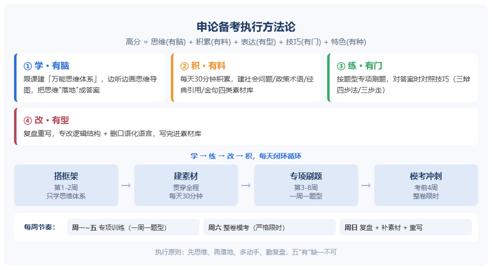

看完笔记，我把它从 "理念" 拆成一套**可以直接照做的执行方法论**。核心就一句话：**高分 = 思维 (有脑) + 积累 (有料) + 表达 (有型) + 技巧 (有门) + 特色 (有种)，五者缺一不可，靠 "输入→输出→改错" 循环推进。**

## 一、四条执行主线（每周循环）

表格

| 主线   | 对应素质 | 每天具体动作                                                 |
| ------ | -------- | ------------------------------------------------------------ |
| **学** | 有脑     | 跟课程建 "申论万能思维体系"，边听边画思维导图，不抄原文      |
| **积** | 有料     | 每天固定 30 分钟积累，进素材库（下面有分类）                 |
| **练** | 有门     | 按题型专项刷题，每道题先列思路再写，对答案时看 "用了什么技巧" |
| **改** | 有型     | 复盘重写，专改两处：逻辑结构 + 口语化语言                    |

**关键动作**：这四条不是并列做一遍就完，而是**每天循环**—— 学完立刻练，练完立刻改，改完补充进素材库。

## 二、四阶段推进

表格

| 阶段        | 时间      | 干什么                                        |
| ----------- | --------- | --------------------------------------------- |
| 1. 搭框架   | 第 1–2 周 | 只学思维体系 + 看真题拆解，**先不急着写整篇** |
| 2. 建素材   | 贯穿全程  | 每天 30 分钟积累，雷打不动                    |
| 3. 专项刷题 | 第 3–8 周 | **一周一个题型**：概括→分析→对策→写作         |
| 4. 模考冲刺 | 考前 4 周 | 整卷限时模考，全流程走完                      |

## 三、每周节奏（假设每天 2 小时）

- **周一～周五**：专项训练，一周攻一个题型
- **周六**：整卷模考（严格限时）
- **周日**：复盘整卷 + 补素材库 + 重写失分部分

## 四、素材库怎么建（四类分库）

1. **社会问题库**：热点事件 → 问题本质 + 政府层面分析
2. **政策术语库**：规范词（如 "放管服"" 双碳 ""基层治理"）
3. **经典引用库**：名言、数据、案例，每条配一个适用话题
4. **金句库**：老师课上讲的好表达，直接摘录

## 五、复盘模板（每写完一篇必答 4 问）

1. **逻辑**：问题 — 原因 — 对策分清了吗？结构有没有乱？
2. **语言**：口水话删干净了吗？术语够规范吗？
3. **技巧**：这题对应的方法（三辩四步法 / 三步走…）用上了吗？
4. **重写**：把失分处重写一遍，写进素材库

