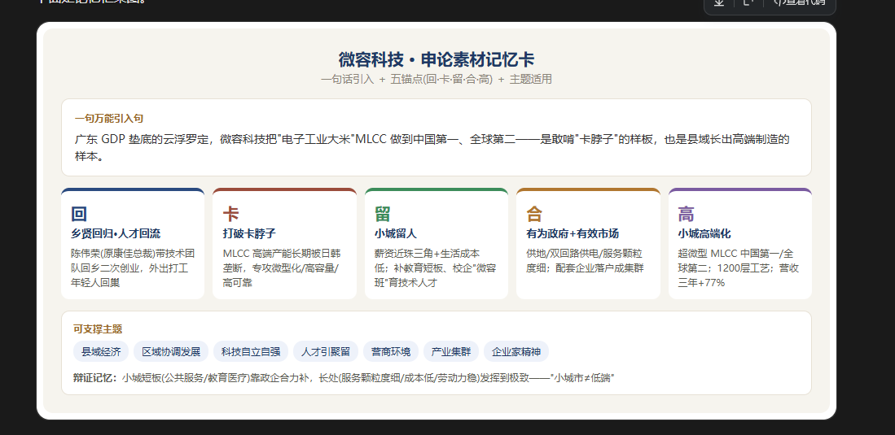

## **小城亦有大作为 —— 以产业为基振兴县域经济**

"郡县治，天下安。" 县域是承上启下的基本单元，更是高质量发展的潜力所在。然而长期以来，受区位、人才、资源所限，不少县域被视为 "低端"" 边缘 " 的代名词。广东云浮罗定，GDP 常年居全省末位，却走出了一家超微型 MLCC 中国第一、全球第二的独角兽微容科技。这启示我们：**县域振兴，关键不在区位禀赋的先天强弱，而在能否找对路子、聚起产业、留住人才，走出一条特色化、高质量的发展之路。**

县域振兴，根基在产业，重在选准特色、聚链成群。产业是县域发展的硬支撑。小县不必贪大求全，而应立足自身禀赋、瞄准细分赛道。微容选择 MLCC 这一 "电子工业大米"，正是看中其体积小、货值高、对运输成本不敏感，天然适合小城布局；更以链主身份带动陶瓷粉体、金属浆料等上游配套企业相继落户，形成小型产业集群。可见，**选准一个特色产业、引入一家链主、带动一串配套，聚链成群**，小城同样能撑起高端制造。

县域振兴，动力在政府，重在优化服务、政企协同。有为政府与有效市场相结合，是县域发展的关键引擎。罗定为微容供地、预留扩产空间、增设双回路供电；小城企业数量少，政府服务颗粒度更细，链主企业的问题往往排在很靠前的位置 —— 这份 "把企业的事当自己的事" 的服务密度，恰是珠三角难以企及的比较优势。政府少一点包办、多一点服务，把要素保障做实、把营商环境做优，企业才敢来、愿留、能做大。

县域振兴，关键在人才，重在引得来、留得住、育得出。人才是产业不 "空心化" 的根本。微容用接近珠三角的薪资和低生活成本留人，更与政府共建公立小学、开办 "微容班"，把教育短板的补齐与一线技能人才的培养一并解决。这说明，**县域引才不能只拼薪酬，更要拼 "安家" 的全链条**：配偶就业、子女入学、医疗养老配齐了，高端人才才会真正扎根。

从百亿家电总裁到独角兽创始人，微容科技把 "不可能" 写在了五线小城。它告诉我们：小城市的短板，要靠政企合力补齐；小城市的长处，要发挥到极致。**产业立基、政府护航、人才为本**，三者同向发力，县域经济定能越过 "天花板"，为高质量发展注入源源不断的基层动能。

主模式确认为流程 / 结构图。核心思路：**这个素材不要只当 "一个例子" 用，要拆成 "分论点支撑 + 对策佐证 + 开头结尾" 多处复用**。针对 "振兴县域经济 / 产业"，我给出一套直接能套的结构和每处的可背示范句。

## 一、先定文章骨架（对应题目问法）

申论考 "县域经济 / 产业"，最常见的考法有两种：

- **提对策题**（"请就振兴县域经济提出对策"）→ 把微容直接拆成对策条
- **议论文**（"以县域振兴 / 产业升级为主题"）→ 用微容做贯穿案例

## 二、议论文用法：一个素材放六个位置（每处一句话可背）

**① 破题引入**（开头点出 "县域也能高端化"）

> 广东云浮罗定，GDP 常年垫底，却走出了超微型 MLCC 中国第一、全球第二的独角兽微容科技。这启示我们：县域振兴，关键不在区位，而在**找对路子、聚起产业**。

**② 立论**（总论点：小城市≠低端）

> 实践证明，县域经济并非低端经济的代名词。微容科技的逆袭说明，立足禀赋、深耕产业链，小城同样能长出 "链主"、走向高端。

**③ 分论点一・产业为本**（选准特色产业 + 链式集聚）

> 县域振兴的根基在产业。微容立足 MLCC 这一体积小、货值高、适合小城布局的 "电子工业大米"，带动上下游配套企业落户，形成集群 ——**以链主带配套，聚链方能成群**。

**④ 分论点二・政府有为**（营商环境 / 服务颗粒度）

> 政府要当好 "服务员"。罗定为微容供地、预留扩产空间、增设双回路供电，让链主企业的问题排在前位 ——**有为政府与有效市场结合，县域才有吸引力**。

**⑤ 分论点三・人才为支撑**（引才・聚才・留才）

> 产业留人，更要环境留人。微容给接近珠三角的薪资、靠低成本留人，又与政府共建学校、办 "微容班" 补短板 ——**引得来、留得住、育得出，产业才不会空心化**。

**⑥ 结尾升华**（小城天花板可破）

> 从家电总裁到独角兽创始人，微容证明：小城短板靠政企合力补、长处发挥到极致。产业、政府、人才同向发力，县域经济同样能越过 "天花板"。

## 三、提对策题的用法：直接把案例提炼成四条对策

1. **选准特色产业**—— 立足资源禀赋，引进 "链主" 企业
2. **优化营商环境**—— 服务颗粒度细、用地 / 供电等要素保障到位
3. **完善人才配套**—— 政企共建教育、产教融合育才，让人才留得下
4. **培育产业集群**—— 以链主带配套，聚链成群、强链补链

读完了。这是关于**微容科技**的报道：原康佳总裁陈伟荣，2017 年回到广东 GDP 垫底的云浮罗定二次创业，做 MLCC（片式多层陶瓷电容器，"电子工业大米"），超微型产品做到中国第一、全球第二，正冲刺创业板。我把整篇浓缩成**可记忆版本**—— 一句话 + 五个锚点 + 主题适用 + 引用金句。

## 一句话记住（可作案例引入句）

> 在广东 GDP 常年垫底的云浮罗定，一家叫**微容科技**的独角兽，把只有细砂大小的 MLCC 做到中国第一、全球第二 —— 这背后，是企业家敢啃 "卡脖子" 硬骨头，也是**县域经济在不起眼处长出高端制造**的样本。

## 五个记忆锚点：回・卡・留・合・高

表格

| 锚点   | 关键词              | 一句话记忆                                                   |
| ------ | ------------------- | ------------------------------------------------------------ |
| **回** | 乡贤回归・人才回流  | 创始人陈伟荣（原康佳总裁）带技术团队回乡二次创业；外出打工的年轻人纷纷回巢入职 |
| **卡** | 打破卡脖子          | MLCC 高端产能长期被日韩垄断，他不甘心，专攻微型化、高容量、高可靠 MLCC |
| **留** | 小城留人            | 薪资接近珠三角 + 本地生活成本低；政府补教育短板、校企合办 "微容班" 育一线技术人才 |
| **合** | 有为政府 + 有效市场 | 政府供地、预留扩产空间、双回路供电、服务颗粒度细；产业链配套企业跟着落户成集群 |
| **高** | 小城高端化          | 超微型 MLCC 中国第一、全球第二；1200 层叠层工艺；2023—2025 营收 10.41→18.45 亿（+77%） |

## 可直接引用的金句

- "MLCC 只有细砂大小，却几乎遍布所有电子产品，业内俗称 ' 电子工业大米 '"
- "这种稳定性比单纯的低工资更有价值"
- "小城市企业数量少，政府服务颗粒度更细，链主企业的问题常常排在很靠前的位置"
- 通篇内核：**"逆向选择"—— 到县里去**

## 可支撑的申论主题（灵活套用）

1. 区域协调发展 / 县域经济高质量发展
2. 科技自立自强 / 关键核心技术攻关
3. 人才工作：引才・聚才・留才 / 乡贤回归
4. 营商环境：有为政府 + 有效市场
5. 产业集群 / 专精特新 / 中小企业
6. 民营企业家精神

## 辩证记忆（防套用空洞）

**小城有短板也有长处**—— 公共服务、教育医疗是短板（靠政企合力补）；政府服务颗粒度细、劳动力稳定、成本低是长处（要发挥到极致）。一句话立场：**小城市不等于低端，"留得住人、聚得起链、攻得下关" 才是县域经济破题关键。**

