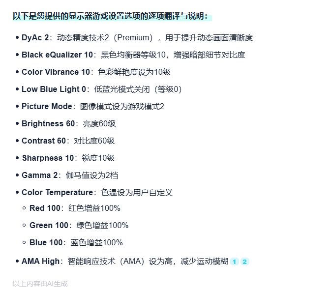

# 这人说的好有道理

中国旅游为什么不行

donk的卓威显示器设置

“为了防止女生早恋所以放张凌赫”，这句话不觉得很奇怪吗。一个孩子在高中时期恋爱，可能ta喜欢的那个人有很多美好品质，让ta心生向往，这就一定比喜欢一个帅气的明星低人一等吗。这个说法并没有引导正确的价值观，仿佛恋爱只追求精致的皮囊。做老师还是应该多想想啊。真正应该提高审美的应该是这位老师自己，这么大个人依旧把颜值放在第一位，追寻虚无缥缈的偶像，尤其内娱这些拿不出半件有分量的作品的所谓偶像。人应该懂得珍惜身边人，学会与平凡的世界相处，而这种「审美」最后只会给人带来颜值焦虑择偶焦虑乃至性焦虑。

