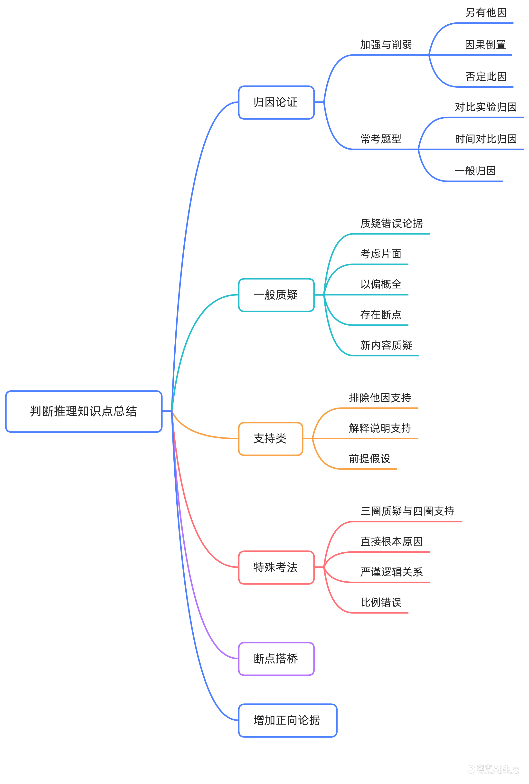

# 逻辑判断（判断推理）知识体系

> 课程考点主文档。所有章节末尾标注来源（老师名 / 课程名 / 真题年份+题号）。
> 顶部"总览 · 知识点全景"图为固定锚点，严禁移动 / 替换 / 删除。

## 总览 · 知识点全景

> 图注：**00 号** · 总览全景图 · 固定锚点，文件名锁定不改（改扩展名/改名会断锚点）

来源：花生老师《3小时速通·27年最新判断推理所有知识点》

---

## 目录

- [一、逻辑判断](#一逻辑判断)
  - [论证（削弱 / 加强）](#论证削弱--加强)
    - [三个质疑方向与力度排序](#三个质疑方向与力度排序)
    - [归因类题型的三条分支](#归因类题型的三条分支)
    - [补全对比实验（三圈质疑 / 四圈支持）](#补全对比实验三圈质疑--四圈支持)
    - [伪他因（削弱方向）](#伪他因削弱方向)
    - [排除他因支持（加强方向）](#排除他因支持加强方向)
    - [解释说明支持：机制要解释到结论上](#解释说明支持机制要解释到结论上)
    - [断点搭桥](#断点搭桥)
    - [增加正向论据](#增加正向论据)
    - [一般质疑（五种打法）](#一般质疑五种打法)
    - [支持类：前提假设](#支持类前提假设)
    - [特殊考法](#特殊考法)
  - [待填章节](#待填章节)
- [二、定义判断](#二定义判断)
- [三、类比推理](#三类比推理)

> 说明：章节顺序与内容骨架对齐上方全景图（归因论证 / 一般质疑 / 支持类 / 特殊考法 / 断点搭桥 / 增加正向论据）。图推已单独成 `图推/` 文件夹，本目录不重复覆盖。

## 一、逻辑判断

> 本章已填：论证（削弱 / 加强）。
> 待填：翻译推理、真假推理、组合排列、日常结论、原因解释。

### 论证（削弱 / 加强）

#### 三个质疑方向与力度排序

加强削弱题目的质疑方向本质只有三种：**另有他因、因果倒置、否定此因**。

| 质疑方向 | 具体做法 | 质疑力度 |
| --- | --- | --- |
| 另有他因 | 承认原有原因存在，另外补充一个原因 | 较弱 |
| 因果倒置 | 把原因与结果的位置颠倒过来 | 强 |
| 否定此因 | 直接切断原因与结果的联系 | 强 |

- **另有他因力度较弱**：它承认了原有原因的存在，只是补充了其他原因。
- **因果倒置力度强**：它从根本上颠倒了因果关系。
- **否定此因力度强**：它直接切断了原因与结果的联系。

**实战取舍（两个削弱项都像时）**：

- **先比攻击位置**：否定此因（抽掉"因"本身）> 因果倒置（颠倒连接）> 另有他因（承认因，只补一个原因）。位置越靠前，力度越强 —— 抽地基 > 断连接 > 补旁证。
- **再查他因三问**：① 这个他因能导致结果吗？② 它在题干对象身上更严重吗？③ 它和题干说的是同一个结果吗？三问有一问答不上，就是**伪他因**。
- **人群锁定**：结论限定了某个特定人群时，优先找"这个人群和普通人不一样"的选项；只讲通用风险因素的，多是伪他因。
- 例：`逻辑推理题目练习.md` 例 7（蛋白粉伤肾，2026 浙江 44%）—— B 否定"过量"这一因，A 只是另有他因，选 B。

#### 归因类题型的三条分支

##### 对比实验归因

- 特点：涉及分组对比，通常分为两组（如实验组与对照组）。
- 解题策略：读完结论后，预设答案方向（另有他因、因果倒置、否定此因），再对照选项快速锁定，避免被无关干扰项迷惑。

##### 时间对比归因

- 特点：从过去到现在的时间维度变化，分析导致现状变化的原因。
- 解题策略：同样预设"另有他因""否定此因"方向（因果倒置通常不符合实际逻辑，较少见）。

##### 一般归因

- 特点：非对比实验，针对某一既定事实或现象分析原因。
- 解题策略：寻找其他原因（另有他因）或直接否定原因。

#### 补全对比实验（三圈质疑 / 四圈支持）

> 口诀「**三圈质疑，四圈支持**」的正式含义：**把对比实验的四格填满**。

对比实验原本只做了"有因 / 无果"两格，结论却要跨到另外两格：

| | 有"因"（如缺钙） | 无"因"（如不缺钙） |
| --- | --- | --- |
| **有"果"（脾气暴躁）** | 题干已给（缺钙 → 脾气暴躁） | **③ 缺这一格** |
| **无"果"（性情温和）** | **④ 缺这一格** | 题干未提，补上也没用 |

- **三圈质疑**：补第 ③ 格 —— "不缺钙的孩子**也**脾气暴躁"。缺少因，结果照样出现，说明因果不成立（否定此因）。
- **四圈支持**：补第 ④ 格 —— "缺钙的孩子**也**性情温和"（用同样一群人做对照）。有因却无果，同样否掉因果。

> ⚠️ 这里有个易混点：**同群人**的"无因有果 / 有因无果"才是比较实验；换成**另一群孩子**的补格（"另一小学不缺钙的孩子也性情温和"）属于个例项，力度很弱，不是"四圈支持"。

> 来源：花生老师《3小时速通·27年最新判断推理所有知识点》
> 例题见 `逻辑推理题目练习.md` → 技巧：补全对比实验（例 6 · 缺钙与脾气暴躁）

#### 伪他因（削弱方向）

- 含义：选项只提出"可能还有其他原因"，既没证明这个原因真实存在，也没证明它确实导致了结果 —— 所以叫"伪"。
- 为什么能削弱：削弱题不要求证成他因，只要给题干的因果搭出一条合理的**替代解释**，就足以动摇结论。
- 有效条件：他因必须落在题干讨论的那批对象上，能解释"为什么『因』多的那一组结果更差"。
  - 落在对象上 → 有效削弱（吃白米饭多的人，其他食物也吃得多）
  - 只泛泛说"世上还有其他原因" → 脱离对象，无关项（遗传等因素也会增加风险）
- 题型信号：题干用**观察对比数据**（最多 vs 最少）推**因果结论**时，天然漏洞就是两组人变量不匹配，直接去找那个不匹配的变量。
- 与力度排序的关系："另有他因较弱"是相对因果倒置、否定此因而言；当选项里没有这两个方向时，有效的伪他因就是最强削弱。

> 例题见 `逻辑推理题目练习.md` → 技巧：伪他因可以削弱观点（例 5 · 白米饭与糖尿病）

#### 排除他因支持（加强方向）

- 原理：支持的核心是"舔"（认同）。通过排除导致结果的其他潜在原因，使得题干中的原因成为唯一或主要因素，从而加强结论。
- 与削弱的关系：削弱题里的"另有他因"，反过来用就是"排除他因支持" —— 把其他可能原因逐一堵死，只留下题干那个因。
- 示例（由削弱题反转变支持题）：
  - 原题（削弱）：熬夜变胖是因为吃多动少（另有他因）。
  - 变题（支持）：确实吃得少、运动量多（排除"吃"和"动"这两个他因，只剩"熬夜"）。
- 典型设问：最能支持 / 最不能支持。注意"最不能支持"常以**话题不一致的无关项**当选，而非削弱项。

> 来源：花生老师《3小时速通·27年最新判断推理所有知识点》
> 例题见 `逻辑推理题目练习.md` → 技巧：排除他因支持（例 3 · 2024 年广东省考 49）

#### 解释说明支持：机制要解释到结论上

- 加强题里"解释原理"确实能加强，但前提是它解释了「**为什么 A 会导致 C**」。
- 只把中间环节说细（"B 是什么"）、没打通到结论（"B 为什么导致 C"）的，属同义重复，不加强。
- 两条判别线：
  1. 讲的是题干**已有信息**还是**新增论据**？—— 重复题干 = 不加强。
  2. 解释到**结论**了吗？—— 只解释中间环节、不解释如何传导到结果的，是无关项。

> 例题见 `逻辑推理题目练习.md` → 技巧：解释机制类选项要解释到结论上（例 4 · 2025 年联考）

#### 断点搭桥

> 待补讲义。本节在全景图中为顶层考点，以下为**按字面理解的提纲，未经课程核对**。

- 定位：题干论据与结论之间**逻辑跳跃**（断点）太大，选项把断点补上即可加强；反之，指出断点存在即可削弱。
- 操作三步：
  1. 把题干拆成「论据 A」→「结论 C」；
  2. 找出 A 与 C 之间**没被证明的那一环**（概念不同 / 范围不同 / 主体不同）；
  3. 选项若把这个断点补成 A → B → C，则是搭桥加强，通常是前提假设类的最强支持。
- 与相邻考点的区分：
  - **断点搭桥**：补的是**题目从没说过**的那一环（必须有它，结论才成立）。
  - **解释说明支持**：补的是"为什么"（机制），题干已给了因果方向。
  - **增加正向论据**：补的是**同一方向的新证据**，不解决断点。

#### 增加正向论据

> 待补讲义。以下为按字面理解的提纲，未经课程核对。

- 定位：结论方向上再添一条**同类新证据**。
- 力度：一般弱于「断点搭桥」「排除他因支持」「反向验证（无因无果）」；因为只是"再举一证"，没堵漏洞也没补断点。
- 易错：与题干**同义重复**的表述不算新论据（见「解释说明支持」判别线 1）；个例（某一个人 / 某一个次）不算正向论据，算个例题。

#### 一般质疑（五种打法）

> 待补讲义。以下为全景图给出的五个子项 + 按字面理解的一句话提纲，未经课程核对。

| 打法 | 一句话理解 | 典型信号 |
| --- | --- | --- |
| 质疑错误论据 | 直接说题干的**论据本身是错的** | 题干论据来自统计 / 调查 / 传闻，可被证伪 |
| 考虑片面 | 论据只看了**一个侧面**，还有别的侧面会影响结论 | "从 X 角度看…"式论据，结论下得过满 |
| 以偏概全 | 用**局部样本**推整体 | 抽样量小、样本单一、地域 / 时间局限 |
| 存在断点 | 论据与结论之间有**逻辑跳跃** | 见「断点搭桥」，这里是反向使用 |
| 新内容质疑 | 选项引入**题干没说过的机制 / 信息**来否定结论 | 选项信息量明显大于题干 |

#### 支持类：前提假设

> 待补讲义。以下为按字面理解的提纲，未经课程核对。

- 定位：题干要成立**必须**具备的条件；常见设问"上述结论的成立还需要补充的前提是""以下哪项是上述论证所假设的"。
- 判别方法：**否定代入法** —— 把选项取反代回题干，如果结论立刻不成立，该选项就是必要前提。
- 与"加强"的区别：加强可以只提高可能性，前提假设必须**不可缺**。

#### 特殊考法

> 待补讲义。以下为全景图给出的四个子项 + 按字面理解的提纲，未经课程核对。

| 考点 | 一句话理解 |
| --- | --- |
| 三圈质疑与四圈支持 | 见前文「补全对比实验」，本质是把对比实验四格填满 |
| 直接根本原因 | 题干给了近因 / 表层原因，选项指出更根本的原因（"真正的原因是…"），属于"另有他因"的强化版本 |
| 严谨逻辑关系 | 选项玩**偷换概念 / 偷换范围 / 偷换条件**；正确项要守住题干原话的严格含义 |
| 比例错误 | 只看比例的分子（或只看绝对数）推结论 —— 例如"患病的人里 X 占比高"推"X 导致患病"，缺分母（基数） |

### 待填章节

> 以下为骨架，待从讲义补齐：翻译推理、真假推理、组合排列、日常结论、原因解释。

## 二、定义判断

> 待填充。

## 三、类比推理

> 待填充。
