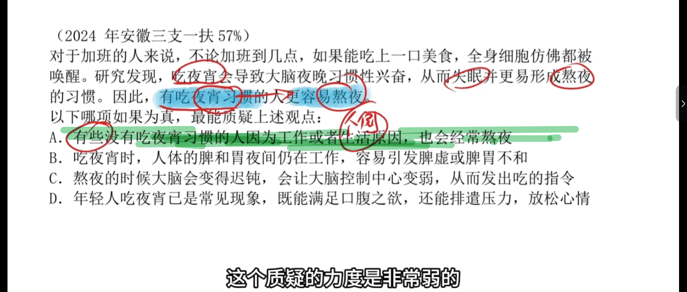
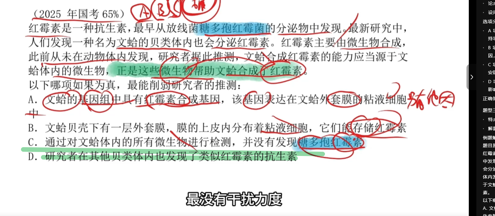
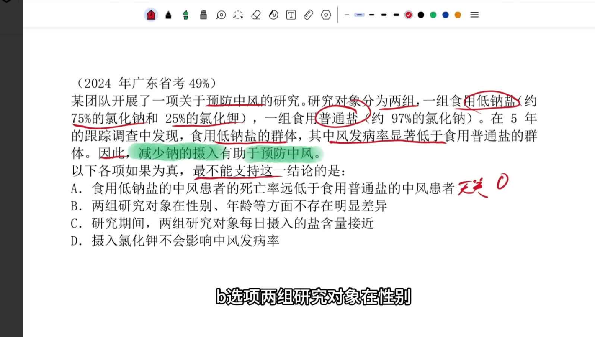
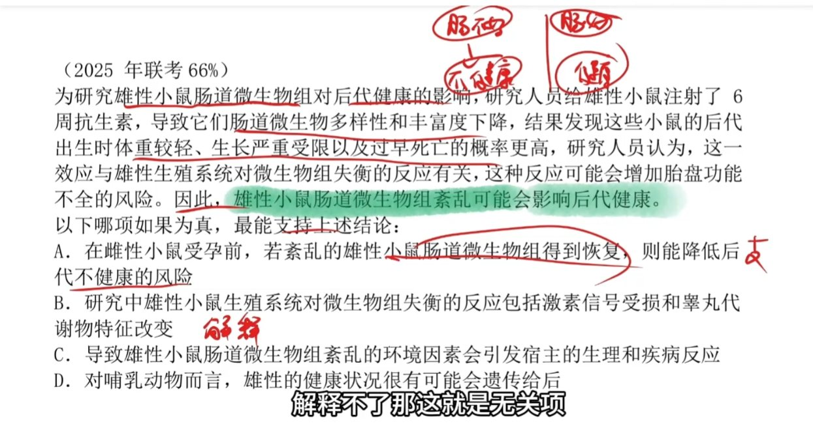
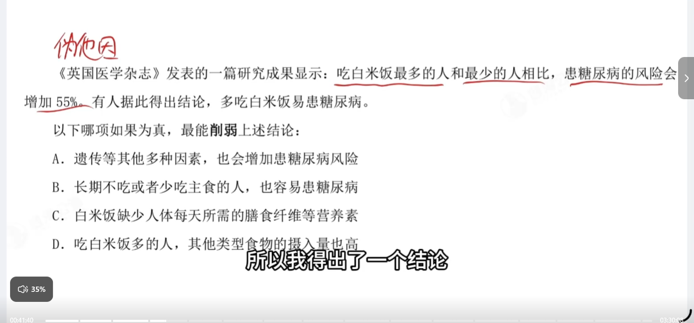
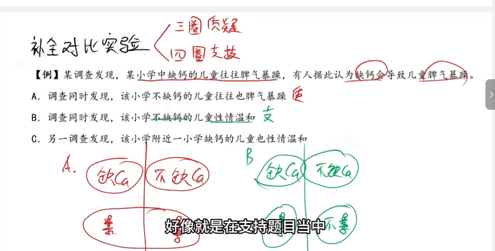
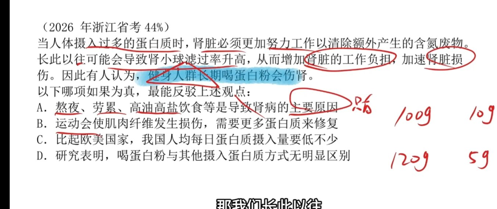

# 题目练习 · 逻辑判断

> 题目记录：每节 = 题目（来源 + 题干）+ 考点提炼 + 来源标注。
> 方法论归 `逻辑推理提纲学习.md`，本文件只记题目与逐项解析。

> 学习备忘（原文保留）：三圈质疑，四圈支持 —— 已查实含义，见提纲「补全对比实验（三圈质疑 / 四圈支持）」。

## 目录

- [技巧：个例项一般都是错的（削弱/加强题型）](#技巧个例项一般都是错的削弱加强题型)
  - [例 1 · A 选项是个例项（2024 安徽三支一扶 57）](#例-1--a-选项是个例项2024-安徽三支一扶-57)
  - [例 2 · C 项是否定此因（2025 年国考 65）](#例-2--c-项是否定此因2025-年国考-65)
- [技巧：排除他因支持（加强题型）](#技巧排除他因支持加强题型)
  - [例 3 · 2024 年广东省考 49](#例-3--2024-年广东省考-49)
- [技巧：解释机制类选项要解释到结论上](#技巧解释机制类选项要解释到结论上)
  - [例 4 · 2025 年联考](#例-4--2025-年联考)
- [技巧：伪他因可以削弱观点](#技巧伪他因可以削弱观点)
  - [例 5 · 白米饭与糖尿病](#例-5--白米饭与糖尿病)
- [技巧：补全对比实验（三圈质疑 / 四圈支持）](#技巧补全对比实验三圈质疑--四圈支持)
  - [例 6 · 缺钙与脾气暴躁（顺序待补）](#例-6--缺钙与脾气暴躁顺序待补)
- [技巧：否定此因 强于 另有他因](#技巧否定此因-强于-另有他因)
  - [例 7 · 2026 年浙江省考 44](#例-7--2026-年浙江省考-44)

## 技巧：个例项一般都是错的（削弱/加强题型）

**规则提炼**：在削弱 / 加强论证题中，"举个别例子"的选项（个例项）一般都不能削弱或加强一般性结论，通常是错误选项。

> 来源：花生老师《3小时速通·27年最新判断推理》—— 具体章节待补。

### 例 1 · A 选项是个例项（2024 安徽三支一扶 57）

> 图注：**01 号** · 个例项削弱 · 2024 安徽三支一扶 57% · 见图即知 A 项为个例项

**题干**：对于加班的人来说，不论加班到几点，如果能吃上一口美食，全身细胞仿佛都被唤醒。研究发现，吃夜宵会导致大脑夜晚习惯性兴奋，从而失眠并更易形成熬夜的习惯。因此，有吃夜宵习惯的人更容易熬夜。

**设问**：以下哪项如果为真，最能质疑上述观点：

- A. 有些没有吃夜宵习惯的人因为工作或者生活原因，也会经常熬夜
- B. 吃夜宵时，人体的脾和胃夜间仍在工作，容易引发脾虚或脾胃不和
- C. 熬夜的时候大脑会变得迟钝，会让大脑控制中心变弱，从而发出吃的指令
- D. 年轻人吃夜宵已是常见现象，既能满足口腹之欲，还能排遣压力，放松心情

**逐项解析**：

- **A 项**："有些没有吃夜宵习惯的人也常熬夜"——"有些"≤ 100 人，是个例项，打不过"更容易"这种概率性一般结论；且它属于"无因有果"，看似否定此因，实则力度极弱。**若把"有些"换成"很多/大多数"，补充规模说明后，它就成为最强的否定此因。**
- **B 项**：吃夜宵 → 脾虚、脾胃不和 —— 讨论的是另一个结果，与"熬夜"无关，**无关项**。
- **C 项**：熬夜 → 大脑迟钝 → 发出吃的指令（想吃夜宵）—— 这是把因果**倒置**的说法，属于强质疑方向。
- **D 项**：年轻人爱吃夜宵的现状与好处，没有触及"吃夜宵是否导致熬夜"，**无关项**。

**正确答案：A**（花生老师讲授口径：个例项，力度非常弱）

- 考点：个例项一般错误；个例项在"否定此因"的壳子下依然打不过概率性结论
- 来源：2024 年安徽三支一扶（正确率 57%）

### 例 2 · C 项是否定此因（2025 年国考 65）

> 图注：**02 号** · 否定此因 · 2025 国考 65% · 文蛤红霉素来源之争

**题干**：红霉素是一种抗生素，最早从放线菌糖多孢红霉菌的分泌物中发现。最新研究中，人们发现一种名为文蛤的贝类体内也会分泌红霉素。红霉素主要由微生物合成，此前从未在动物体内发现，研究者据此推测，文蛤合成红霉素的能力应当源于文蛤体内的微生物，正是这些微生物帮助文蛤合成了红霉素。

**设问**：以下哪项如果为真，最能削弱研究者的推测：

- A. 文蛤的基因组中具有红霉素合成基因，该基因表达在文蛤外套膜的粘液细胞中
- B. 文蛤贝壳下有一层外套膜，膜的上皮内分布着粘液细胞，它们能存储红霉素
- C. 通过对文蛤体内的所有微生物进行检测，并没有发现糖多孢红霉素
- D. 研究者在其他贝类体内也发现了类似红霉素的抗生素

**逐项解析**：

- **A 项**：文蛤**自己的基因组**里就有合成基因 —— 来源是文蛤自身，不是微生物，**否定此因**，最强削弱，**当选**。
- **B 项**：粘液细胞"能**存储**红霉素" —— 只说了存哪儿，没说谁合成，可能仍是微生物合成的。这是教学视频"B 选项"红笔质疑的落点。
- **C 项**："没发现糖多孢红霉素"——注意：糖多孢红霉素只是**红霉素的前体**，而题干说的是"红霉素"；换个说法是没检出前体≠不会合成红霉素，检测对象偷换了，**质疑力度弱**（教学视频旁批）。
- **D 项**：其他贝类也有类似抗生素 —— 与文蛤红霉素的来源无关，**无关项**，教学视频标注"最没有干扰力度"。

**正确答案：A**（花生老师讲授口径：红笔批注上方即 A、B、C 上标）

- 考点：否定此因 > 机制细节描述；⚠️ 原笔记曾把本题误归为"D 项是个例项"，实际 D 是无关项、本题考"否定此因"，已更正
- 来源：2025 年国考（正确率 65%）

## 技巧：排除他因支持（加强题型）

**规则提炼**：支持的核心是"舔"（认同）。把导致结果的其他潜在原因逐一排除，使题干中的原因成为唯一或主要因素，结论即被加强。削弱题里的"另有他因"，反过来用就是"排除他因支持"。

> 原理见 `逻辑推理提纲学习.md` → 一、逻辑判断 → 论证（削弱 / 加强）→ 排除他因支持。

### 例 3 · 2024 年广东省考 49

> 图注：**03 号** · 排除他因支持 · 2024 广东 49% · 低钠盐与预防中风

**题干**：某团队开展了一项关于预防中风的研究。研究对象分为两组，一组食用低钠盐（约 75% 的氯化钠和 25% 的氯化钾），一组食用普通盐（约 97% 的氯化钠）。在 5 年的跟踪调查中发现，食用低钠盐的群体，其中风发病率显著低于食用普通盐的群体。因此，减少钠的摄入有助于预防中风。

**设问**：以下各项如果为真，最不能支持这一结论的是：

**逐项解析**：

- **A 项**：讨论的是"中风后的死亡率"，而题干讨论的是"中风发病率"，话题不一致，属于无关项 —— **当选**。
- **B 项**：排除年龄、性别差异对他因的影响，属于排除他因支持 —— 能加强，排除。
- **C 项**：排除每日摄入盐总量不同这一他因的影响，属于排除他因支持 —— 能加强，排除。
- **D 项**：排除氯化钾（低钠盐成分之一）影响发病率这一他因，属于排除他因支持 —— 能加强，排除。

**正确答案：A**

- 考点：排除他因支持 + 话题不一致无关项（"最不能支持"选无关项，而非选削弱项）
- 来源：2024 年广东省考第 49 题（正确率 49%）

## 技巧：解释机制类选项要解释到结论上

**规则提炼**：加强题里"解释原理"确实能加强，但前提是它解释了「**为什么 A 会导致 C**」。只把中间环节说细（"B 是什么"）、没打通到结论（"B 为什么导致 C"）的，属于同义重复，不加强。

**两条判别线**：

1. 它讲的是题干**已有信息**，还是**新增论据**？—— 重复题干 = 不加强。
2. 它解释到**结论**了吗？—— 只解释中间环节、不解释如何传导到结果的，是无关项。

> 原理见 `逻辑推理提纲学习.md` → 一、逻辑判断 → 论证（削弱 / 加强）→ 解释说明支持。

### 例 4 · 2025 年联考

> 图注：**06 号** · 反向验证支持 · 2025 联考 66% · 抗生素 → 肠道微生物↓ → 后代体弱

**题干**：研究人员探究雄性小鼠肠道微生物组对后代健康的影响。给雄性小鼠注射 6 周抗生素后，其肠道微生物的多样性和丰富度下降；这些小鼠的后代出生时体重较轻、生长严重受限、过早死亡的概率更高。研究人员认为，这一效应与雄性生殖系统对微生物组失衡的反应有关，这种反应可能增加胎盘功能不全的风险。由此得出结论：雄性小鼠肠道微生物组紊乱可能影响后代健康。

**设问**：以下各项如果为真，最能支持上述结论的是：

**逐项解析**：

- **A 项**：在雌性小鼠受孕前，若紊乱的雄性小鼠肠道微生物组得到恢复，则能降低后代不健康的风险 —— 反向验证（无因无果），同时证明因果方向与因果必要性，力度最强，**当选**。
- **B 项**：生殖系统对微生物组失衡的反应包括激素信号受损和睾丸代谢物特征改变 —— 只是把题干已有的"生殖系统反应"说细，属同义重复；且未说明这些改变如何传导到胎盘与后代，**不加强**。
- **C 项**：导致雄性小鼠肠道微生物组紊乱的环境因素会引发宿主的生理和疾病反应 —— 主体是宿主（成年雄鼠）自身，与"后代健康"脱靶。
- **D 项**：对哺乳动物而言，雄性的健康状况很有可能遗传给后代 —— "健康状况"偷换了"肠道微生物组紊乱"，且"很有可能"是模糊断言，未落到本题机制。

**正确答案：A**

- 考点：反向验证（无因无果）力度最强；"解释机制"必须解释到结论上才算加强
- 来源：2025 年联考（正确率 66%）

## 技巧：伪他因可以削弱观点

**规则提炼**：所谓"伪他因"，是选项只提出「可能还有其他原因」，既没有证明这个原因真实存在，也没有证明它确实导致了结果。但削弱题**不要求把他说成**，只要能给题干的因果搭出一条合理的**替代解释**，就足以动摇结论 —— 所以伪他因可以削弱。

**但要过一道关**：他因必须落在题干讨论的那批对象身上，能解释"为什么『因』多的那一组结果更差"。

- 落在对象上 → 有效削弱（例 5 的 D）
- 只泛泛说"世上还有其他原因" → 脱离对象，是无关项（例 5 的 A）

**题型信号**：题干用「吃最多 vs 吃最少」这类**观察对比数据**推出**因果结论**时，天然漏洞就是"两组人在别的变量上并不匹配"，直接去找那个不匹配的变量。

> 原理见 `逻辑推理提纲学习.md` → 一、逻辑判断 → 论证（削弱 / 加强）→ 伪他因（削弱方向）。

### 例 5 · 白米饭与糖尿病

> 图注：**05 号** · 伪他因削弱 · 白米饭与糖尿病 · 答案 D

**题干**：《英国医学杂志》发表的一篇研究成果显示：吃白米饭最多的人和最少的人相比，患糖尿病的风险会增加 55%。有人据此得出结论，多吃白米饭易患糖尿病。

**设问**：以下哪项如果为真，最能削弱上述结论：

- A. 遗传等其他多种因素，也会增加患糖尿病风险
- B. 长期不吃或者少吃主食的人，也容易患糖尿病
- C. 白米饭缺少人体每天所需的膳食纤维等营养素
- D. 吃白米饭多的人，其他类型食物的摄入量也高

**逐项解析**：

- **A 项**：只说"遗传等其他因素也会增加风险"，却没说明吃白米饭多的人在这些因素上是否更多，解释不了那 55% 的差距 —— 泛泛的他因，**削弱力度弱**（教学视频批注为"伪他因"）。
- **B 项**：偷换概念，"主食"≠"白米饭"；且"不吃主食的人也容易患病"只是补一格"无因有果"，跟 A 一个层次，否定不了"多吃白米饭易患病"，两个原因可以并存。
- **C 项**：白米饭缺膳食纤维 → 更易血糖异常，这是在解释致病机制，属**加强**项（方向相反，最易误选）。
- **D 项**：吃白米饭多的人其他食物摄入量也高，那 55% 的差距完全可能由其他食物造成，白米饭只是搭便车 —— **另有他因**，直接削弱，**当选**。

**正确答案：D**

- 考点：伪他因可以削弱观点 —— 削弱不要求证明他因成立，但要能解释"因多那一组结果更差"；⚠️ 原笔记把 A 判为"无关项"，按教学视频口径 A 是**力度很弱的伪他因**（仍属可质疑项），已更正
- 来源：待补（真题年份 + 题号）

## 技巧：补全对比实验（三圈质疑 / 四圈支持）

**规则提炼**：对比实验题把"有因有果"那一格给你，要求你补另外两格。

- **第三格（质疑）**：无因 + 有果 —— "没有这个因，结果照样出现"。
- **第四格（支持）**：有因 + 无果 —— "有因却不出结果"，前提是**同一群人**的对照。

> 原理见 `逻辑推理提纲学习.md` → 一、逻辑判断 → 论证（削弱 / 加强）→ 补全对比实验（三圈质疑 / 四圈支持）。

### 例 6 · 缺钙与脾气暴躁（顺序待补）

> 图注：**04 号** · 补全对比实验 · 三圈质疑 / 四圈支持四格示意图

**题干**：某调查发现，某小学中缺钙的儿童往往脾气暴躁，有人据此认为缺钙会导致儿童脾气暴躁。

**设问**：原截图未带设问。（原图只有手写口诀与 A/B 两选项的解题示意图，截图错位到后一页；完整的 A–D 选项与设问待补讲义核对。）

**逐项解析（依据截图手写批注）**：

- **A 项**：调查同时发现，该小学**不缺钙**的儿童往往**也脾气暴躁** —— 补第三格（无因有果），**质疑**，批注"反"。
- **B 项**：调查同时发现，该小学**不缺钙**的儿童**性情温和** —— 批注"支"，但注意这一格题干并未给出"缺钙的孩子暴躁"以外的对照，严格说它等于重复题干，加强力度有限。
- **C 项**：另一调查发现，该小学**附近一小学**缺钙的儿童也性情温和 —— 换了**另一群人**，属个例项，力度很弱，不是真正的"四圈支持"。

**正确答案：待补**（推断为 A）

- 考点：三圈质疑 / 四圈支持；及"补格要补**同群人**，换群人就是个例项"
- 来源：待补（截图取自花生老师《3小时速通》判断推理加强削弱章节，播放位置约 41:40）

## 技巧：否定此因 强于 另有他因

**规则提炼**：两个削弱项都看着能打时，别比"像不像"，比**打在论证链的哪一环**。

- 力度排序：**否定此因**（抽掉"因"本身，因不成立）> **因果倒置** > **另有他因**（承认因，只补一个原因）。
- 位置越靠前越强：抽地基 > 断连接 > 补旁证。
- 另有他因类选项还要过三问：① 这个他因能导致结果吗？② 它在题干对象身上更严重吗？③ 它和题干说的是同一个结果吗？三问有一问答不上，就是**伪他因**。

**人群锁定的特殊判断**：结论限定了某个特定人群时，优先找"这个人群和普通人不一样"的选项；只讲通用风险因素的，多是伪他因。

> 原理见 `逻辑推理提纲学习.md` → 一、逻辑判断 → 论证（削弱 / 加强）→ 三个质疑方向与力度排序 → 实战取舍。

### 例 7 · 2026 年浙江省考 44

> 图注：**07 号** · 否定此因 · 2026 浙江 44% · 蛋白粉与伤肾

**题干**：当人体摄入过多的蛋白质时，肾脏必须更加努力工作以清除额外产生的含氮废物。长此以往可能会导致肾小球滤过率升高，从而增加肾脏的工作负担，加速肾脏损伤。因此有人认为，健身人群长期喝蛋白粉会伤肾。

**设问**：以下哪项如果为真，最能反驳上述观点：

- A. 熬夜、劳累、高油高盐饮食等是导致肾病的主要原因
- B. 运动会使肌肉纤维发生损伤，需要更多蛋白质来修复
- C. 比起欧美国家，我国人均每日蛋白质摄入量要低不少
- D. 研究表明，喝蛋白粉与其他摄入蛋白质方式无明显区别

**论证链**：喝蛋白粉（健身人群）→ **摄入过多**（隐含前提）→ 肾负担加重 → 伤肾

**逐项解析**：

- **A 项**：另有他因，但三层都弱 —— ①"主要**原因**"≠"唯一原因"，只给结论降级，没有否定结论；② 没说明健身人群在熬夜、劳累、高油高盐上更严重，他因**没落到对象上**（视频批注"伪"）；③ 题干说"加速肾损伤"，A 说"导致肾病"，话题有偏差。
- **B 项**：运动使肌肉纤维损伤、需要更多蛋白质修复 → 健身人群的蛋白质需求阈值本就更高，喝蛋白粉是补需求，不是过量 —— **否定此因**，抽掉"摄入过多"这一环，**当选**。
- **C 项**："人均"≠"健身人群"，"比欧美低"也不代表不过量，**无关项**。
- **D 项**：蛋白粉与其他蛋白质方式无区别，恰恰说明蛋白粉就是蛋白质、喝多了照样伤肾，属**加强**项（方向相反）。

**正确答案：B**

- 考点：否定此因 强于 另有他因；结论锁定特定人群时，找"这个人群和普通人不一样"的选项
- 来源：2026 年浙江省考（正确率 44%）
